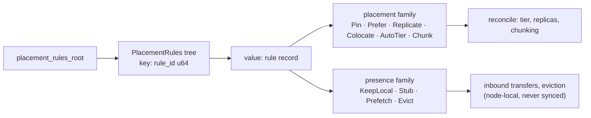
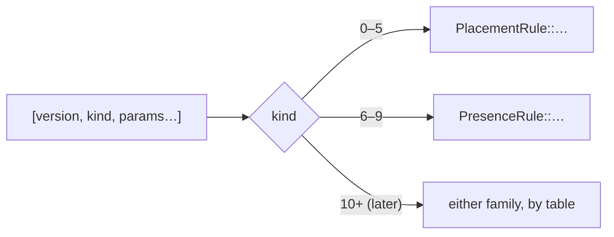
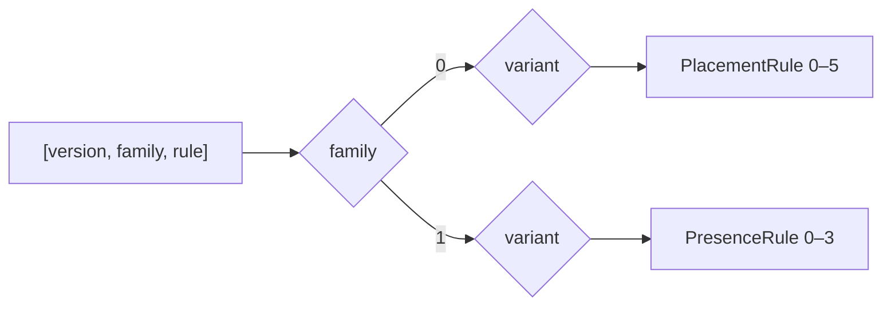

# Pool management — open decisions

Design: [pool-design.md](pool-design.md) · Plan: [pool-implementation-plan.md](pool-implementation-plan.md)

## POOL-D2 — Quotas

The original requirements list filesystem quotas; the design has none. Decide whether quotas exist and what they bound (bytes or objects per tag query, per ontology module, per Mettā principal), and whether they are enforced at write time or reported by reconcile. Without paths, a quota is naturally a placement-style rule over a query.

## POOL-D3 — Time-triggered rules

Placement and presence rules follow mutations through the match index (SUBSCRIPTIONS-DESIGN "Evaluation"), which is consulted only when an object changes. Rules that depend on time passing — `AutoTier` (tier by access age), the presence rule `Evict` (drop local chunks after `unused_ns` without access, SPECIFICATION-DESIGN§8.3), and any rule comparing a timestamp with "now" (e.g. modified more than 30 days ago) — are never re-checked for an object nobody touches. The query language has no now-relative predicate yet either.

Direction: **bucket terms with time wheels**, so that several granularities are served.

- Each time-based rule names a timestamp (`modified`, `created`, access time per [METADATA-D7](metadata-decisions.md)) and a threshold. The timestamp has `Bucket` terms at the granularities in use (hour, day, week…), created internally when no ontology rule declares them (ONTOLOGY-DESIGN "Rules and constraints").
- A time wheel per granularity fires at each bucket boundary. When a boundary passes, the objects that just crossed a rule's threshold are the postings of one bucket term — the one that has aged out — so a trigger is one posting read per rule per tick, and the matching objects enqueue reconcile work.
- Thresholds finer than the coarsest fitting bucket use a deadline wheel: an object entering the boundary bucket gets an entry keyed `(deadline, oid, rule)`, popped by the engine's `step` when due.

To decide: the granularities offered and which wheel serves each; whether the wheel's pending deadlines are persisted (a tree) or rebuilt from bucket postings at mount; how a now-relative predicate is written in the query language; how ticks missed while the pool was offline are caught up (one catch-up read per elapsed bucket); and the cost bound per tick. Blocks `AutoTier` and `Evict` ([POOL4](pool-implementation-plan.md), [POOL9](pool-implementation-plan.md), [RECONCILE5](reconcile-implementation-plan.md)).

## POOL-D4 — Bounds on pool composition

Only id widths bound how many nodes and disks a pool has: `NodeId` (65 536) and `disk_id` (65 536 ever added, ENGINE-DESIGN§1.2). Nothing says how many may be present at once, nor whether a removed disk's `DiskDescriptor` is kept (as a tombstone naming the never-reused id) or deleted once its evacuation completes. Every structure holding one entry per node or disk — object roots, disk descriptors, cluster peers, and the checkpoint entry if [ENGINE-D2](engine-decisions.md) (c) carries them — needs a worst case. To decide: the maximum cluster node count, the maximum present disks per pool, and the fate of removed disks' descriptors.

## POOL-D5 — Pool event log and statistics

The superblock no longer counts mounts or records the last mount time, since it is rewritten only on clean unmount and when the journal list changes (ENGINE-DESIGN§1.1). Mount history and similar operational statistics need a home that is written anyway. Sketch, not decided:

- **Counters** in the pool state record (POOL-DESIGN§1.2), advanced in the checkpoint each event already writes: `mounts`, `unclean_mounts` (a mount whose replay found entries after the newest checkpoint), `last_mount_ns`, `last_clean_unmount_ns`, and per disk `mounts_seen` in its descriptor if per-device history matters (the descriptor already carries the disk's error counters, POOL-DESIGN§1.1).
- **An event log** generalising today's `errors: [ErrorEntry]` (newest 64): `PoolEvent = [lsn, time_ns, kind, detail]` with kinds for mount, clean unmount, unclean recovery, disk added, removed or failed, disk state changed by the health component, latency outlier, unrecoverable read, head switch, rule rework started and finished, and the reconcile errors of RECONCILE-DESIGN§1.7; kept as the newest N, with counters surviving the window.
- **Where it lives:** the pool state record while it stays small, or its own bounded tree if N grows; bounded by [RECONCILE-D1](reconcile-decisions.md) (`detail` cap) and part of [ENGINE-D2](engine-decisions.md)'s checkpoint size.

To decide: the counter set, the event kinds, N, and whether `brunnr status` reports from it.

## POOL-D7 — Encoding of placement and presence rules

**Context.** `RootPointer.placement_rules_root` roots one `BtreeKind::PlacementRules` tree, one
entry per rule keyed by its id from the `PlacementRule` counter (POOL-DESIGN§1.1, [POOL5](pool-implementation-plan.md)). It holds two rule
families (SPECIFICATION-DESIGN§8.3): **placement** rules (`Pin`, `Prefer`, `Replicate`,
`Colocate`, `AutoTier`, `Chunk`), which reconcile acts on, and **presence** rules (`KeepLocal`,
`Stub`, `Prefetch`, `Evict`), which drive inbound transfers and eviction and are never synced
([POOL9](pool-implementation-plan.md)). Every rule is loaded at mount and registered as a watcher in the match index, so no
reader ever scans the tree for one family. Both are committed by checkpoint, a handful to a few
hundred records per pool. The value is a top-level positional CBOR record (FORMAT-DESIGN§1.6):
element 0 is the schema version, and the record must say which rule it is.



**(a) One flat numbering.** `RuleRecord = [version, kind, params…]`, `kind` 0–5 placement and
6–9 presence; a new rule of either family takes the next free number.

```text
[1, 0, query, tier]                  // Pin
[1, 2, query, min_replicas, across]  // Replicate
[1, 6, query]                        // KeepLocal
[1, 7, query, prefix_bytes]          // Stub
```



- Decode is one `match` on `kind`; a record is one element shorter than in (b).
- The family is a property of the number, so it needs a table. Kinds added later interleave: a
  seventh placement rule would be 10, after the presence rules, and every family test
  (`is_presence(kind)`) grows with it.
- The two Rust enums of SPECIFICATION-DESIGN§8.3 no longer map 1:1 onto their indices
  (`KeepLocal` is variant 0 of `PresenceRule` but kind 6 on disk), so the codec carries an
  offset or a merged enum.

**(b) Family, then that family's own index.** `RuleRecord = [version, family, rule]`, `family`
0 placement, 1 presence; `rule = [variant, params…]` indexed within its family from 0.

```text
[1, 0, [0, query, tier]]                  // placement Pin
[1, 0, [2, query, min_replicas, across]]  // placement Replicate
[1, 1, [0, query]]                        // presence KeepLocal
[1, 1, [1, query, prefix_bytes]]          // presence Stub
```



- Each family's variant index is its Rust enum's position, so each enum has its own small codec
  and grows independently (a new placement rule is placement variant 6, whatever presence adds).
- "Is this a presence rule?" is one element, which is what the never-synced filter and POOL9's
  registration need.
- Two bytes more per record (the family and the inner array head); a two-level `match`.

**Cost.** Both are about the same code: two hand-written codecs of 6 and 4 variants over the
QUERY-DESIGN§1.2 query codec, and the same tests (fixed bytes per variant, unknown index
rejected). Space is negligible either way at a few hundred records. The difference is
evolution: (a) is flatter today and interleaves families as rules are added; (b) keeps each
family's numbering dense and its own. A third shape, the family in the key
(`(family: u8, rule_id: u64)`), behaves like (b) for decoding but makes the family part of every
lookup; since all rules are loaded at mount, it buys nothing. Recommendation: (b).

Shapes [SPEC25](specification-implementation-plan.md), [POOL5](pool-implementation-plan.md) and [POOL9](pool-implementation-plan.md).

## Future work

- None recorded.
