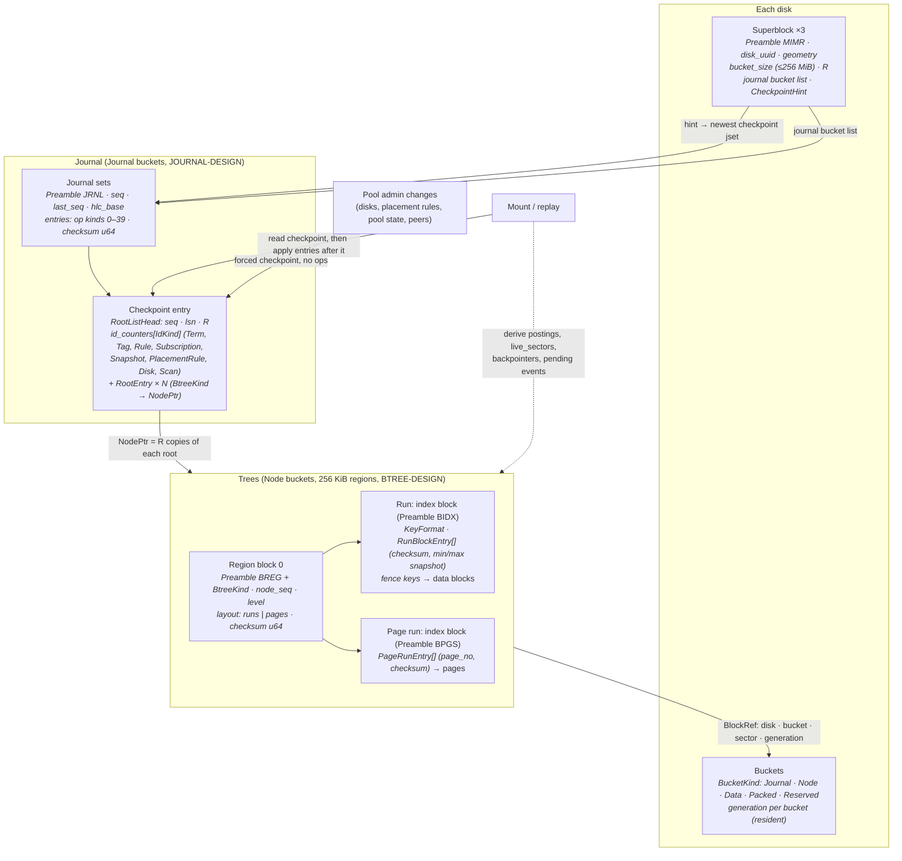
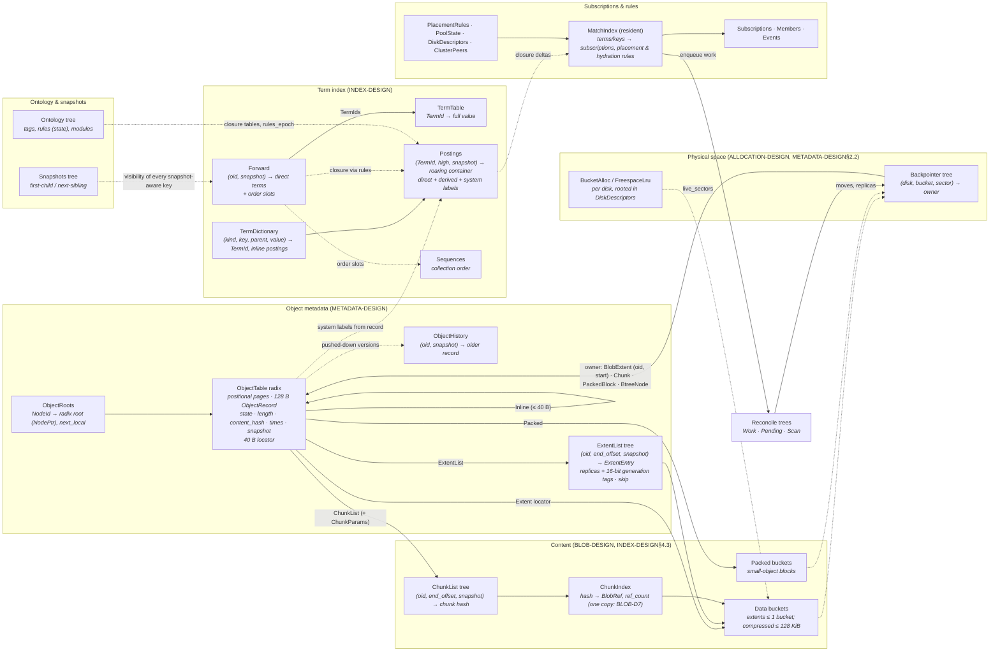

# Mímisbrunnr — The Well of Knowledge

**An associative filesystem for the Mettā operating system**

_Mímisbrunnr is the well at the root of Yggdrasil that holds all knowledge and wisdom. Odin sacrificed an eye for a single drink from it. In our system, each node sacrifices a few hundred megabytes to replicate all metadata — and gains the ability to see everything._

**Mímir** — the guardian of the well — is the query engine. You ask Mímir a question (a tag query), Mímir looks into the well (bitmap indexes), and returns answers.

Plan: [specification-implementation-plan.md](specification-implementation-plan.md) · Open decisions: [specification-decisions.md](specification-decisions.md) · Completed: [specification-completed.md](specification-completed.md) · Order: [operations-plan.md](operations-plan.md)

## About this document

This is the authoritative system design. The authoritative on-disk and algorithmic specification is the set of numbered "Format specification" sections in the scope design documents, listed in format order by [format-design.md](format-design.md). Cross-references use `SCOPE-DESIGN§n` form: "SPECIFICATION-DESIGN§n" is section n of this document, "INDEX-DESIGN§1.2" is section 1.2 of `index-design.md`, and so on.

Rules for editing it:

- **No process language.** No phase or item names, dates, "amended", "TODO", or "until R6"-style qualifiers. Implementation gaps live in the implementation plans.
- **One home per fact.** Each structure is defined once; other sections link to it.
- **Numbered headings are stable anchors.** Renumbering requires re-verifying every `SCOPE-DESIGN§n` reference to the renumbered document ([TOOLING5](tooling-implementation-plan.md)).
- Appendix B records where the design came from and Appendix C the alternatives it rejected; neither is normative.

---

https://futurism.com/the-byte/gen-z-kids-file-systems

---

## 1. Design Philosophy

Mímisbrunnr abandons hierarchical directories entirely. There are no folders, no paths, no tree structure. Every object (file) exists in a flat space and is discoverable through **associative queries** over its metadata — tags, attributes, relations, and ontological inference.

The design separates three concerns completely:

- **Metadata** (tags, attributes, ontology) — small, replicated everywhere, always searchable
- **Content** (blob data) — large, lives where placed, fetched on demand
- **Policy** (placement, tiering, encryption, compression) — driven by the ontology, not by location

This separation means any node in a cluster can search the entire filesystem instantly (metadata is local), while blob content only moves over the network when actually opened.

### 1.1 Naming

The system follows a Norse mythological naming convention consistent with the broader Mettā ecosystem:

| Name            | Component                   | Mythological basis                |
| --------------- | --------------------------- | --------------------------------- |
| **Mímisbrunnr** | The filesystem itself       | The well containing all knowledge |
| **Mímir**       | Query engine / daemon / CLI | The wise guardian you consult     |

```
brunnr create /dev/nvme0n1 /dev/sda      # forge the well across disks
brunnr mount                             # open the well

mimir query "electronic AND year:2024"   # consult the wise one
mimir tag obj:42 ambient chill           # add knowledge to the well
```

---

## 2. Data Model

### 2.1 Objects

Every file is an **object** with a globally unique ID and a bag of assertions about it. Objects have no intrinsic name — "name" is just another attribute.

```rust
// Node-prefixed bitfield: top 16 bits = node ID, bottom 48 = local seq
#[bitfield(u64)]
struct ObjectId {
    #[bits(0..=47, rw)]
    local: u48,
    #[bits(48..=63, rw)]
    node: u16,
}

// Newtype wrapper
struct TagId(u32);
```

The node prefix lets every node create objects without coordinating with others once it holds a cluster-unique `NodeId`; how a node obtains one, which does take coordination, is CLUSTER-D1. Each node can create 281 trillion objects (48-bit local sequence) — at 1000 objects per second, that's ~8,900 years before exhaustion.

Additional type aliases used throughout:

```rust
type NodeId = u16;
type DiskId = u16;
type SubscriptionId = u64;
type ModuleId = String;
```

Object IDs are **never recycled**. The 48-bit space is sufficient, and non-recycling eliminates an entire class of stale-reference bugs across cluster sync. Records carry no generation counter: without reuse a bare `ObjectId` is unambiguous (METADATA-DESIGN "Object deletion").

### 2.2 Assertions

Each object carries a bag of assertions — statements about what it is:

```rust
enum Assertion {
    Tag(TagId),                                      // "this is electronic music"
    Attr { key: TagId, value: Value },               // "artist = Aphex Twin"
    Relation { predicate: TagId, target: ObjectId }, // "member_of playlist:900"
}

enum Value {
    Text(String),
    Int(i64),
    Float(f64),
    Timestamp(i64),
    Blob(Vec<u8>),
}
```

Multi-valued attributes are natural — an object can have multiple assertions with the same key. A music track in two playlists simply has two `playlist` attributes.

An object's **direct** assertions are the ones a user or application set; its **derived** terms are the ones the ontology's rules add. The forward index stores direct assertions only; derived terms are the closure of the direct ones under the rules, recomputed when needed, and appear in postings so queries never expand rules (§3.3, INDEX-DESIGN§2.4).

### 2.3 Query Algebra

Queries are set operations over object sets, evaluated bottom-up via bitmap algebra:

```rust
enum Query {
    HasTag { tag: TagId, direct: bool },  // direct = false: carries the tag directly or derived —
                                          //   "vehicle" matches "car", "truck" (§3.3)
    HasKey(TagId),                        // has any value of the attribute key
    HasAttr { key: TagId, op: CmpOp, value: Value },
    Under { key: TagId, path: Value },    // hierarchical keys: the value or anything below it
    Related { predicate: TagId, target: ObjectId },
    And(Vec<Query>),
    Or(Vec<Query>),
    Not(Box<Query>),                      // complement within the live objects
}

enum CmpOp { Eq, Ne, Lt, Le, Gt, Ge, Prefix, Contains }
```

- **Derived terms make `IsA` unnecessary:** postings hold every object a rule derives a tag
  for, so `HasTag` already answers the ontology-aware question; `direct: true` restricts the
  match to objects that carry the tag themselves, checked against forward entries.
- **The universe is the live objects.** The engine posts every object it creates to the
  system label `_object` and removes it at tombstone (METADATA-DESIGN "Object deletion");
  `Not(q)` is `_object − q`, so tombstoned objects never appear.
- **System terms.** Engine-maintained labels expose record facts to queries: `_object`
  (live), `_presence:remote` (content held by other nodes only), `_writing` (a stream not yet
  closed). They are derived from the record into postings and never stored as asserted terms;
  users and applications cannot assert or remove them (ONTOLOGY-DESIGN "Tags and attribute
  keys", INDEX-DESIGN§2.4).
- **Record fields** (`size`, `created`, `modified`, `changed`) are not attributes: SQL exposes
  them as columns filtered after the indexed part of a query, and ontology `Bucket` rules take
  them as inputs, so `created-month = 2026-11` or `size-class = 1-10MiB` are derived, indexed
  terms (ONTOLOGY-DESIGN "Rules and constraints").
- **Stored and compiled forms.** A query that is persisted — a subscription, a placement rule —
  names tags by `TagUid` so it survives renames and travels between nodes. Before evaluation it
  is compiled into `TermId`s and dictionary ranges, and recompiled only when the ontology's
  `rules_epoch` advances or a term it references changes (QUERY-DESIGN "Evaluation").

Example — "all portable electronics from 2024, not discontinued":

```rust
And(vec![
    HasTag { tag: tag("electronics"), direct: false },
    HasTag { tag: tag("portable"), direct: false },
    HasAttr { key: tag("year"), op: Eq, value: Int(2024) },
    Not(Box::new(HasTag { tag: tag("discontinued"), direct: false })),
])
```

---

## 3. Ontology Layer

The ontology defines relationships between tags themselves. It is the schema of the filesystem and drives all storage behavior — placement, compression, encryption, chunking.

### 3.1 Tags and attribute keys

Every tag has two identities: a 128-bit `TagUid`, derived from its module id and name (random for ad-hoc tags), which names it in modules, exports and sync; and a dense local `TagId` (`u32`), which is its `TermId` in the index. A tag has a canonical name, aliases, and a qualified name `module:name` for when two modules use the same name (ONTOLOGY-DESIGN "Tags and attribute keys").

```rust
enum TagKind {
    Label,
    AttributeKey { value_type: ValueType },
    RecordField { field: RecordField },   // size, created, modified, changed: read from the
                                          //   object record, never asserted (core ontology)
}
enum ValueType { Text, Int, Float, Timestamp, Blob }
enum Collection { Plain, Grouping, Ordered, Ranked }   // attribute keys

struct TagRecord {
    uid: TagUid,
    name: String,
    aliases: Vec<String>,
    kind: TagKind,
    collection: Collection,              // grouping: values name groups (a project, an album);
                                         //   ordered / ranked: each group keeps a sequence
    hierarchy_separator: Option<char>,   // values are paths: "europe/france/paris"
    ngram: Option<u8>,                   // substring search over the key's values
    storage: Option<StoragePolicy>,      // §3.5
    provenance: Vec<ModuleUid>,          // modules declaring the tag
    system: bool,                        // engine-maintained label (_object, _presence:remote,
                                         //   _writing); users cannot assert it
}
```

The on-disk record is ONTOLOGY-DESIGN§1's `TagRecord`; this is its logical shape. A label is asserted or not (`favorite`, `electronic`); an attribute key carries a value (`artist = "Aphex Twin"`). Groups are attribute values: `playlist = "workout"` puts an object in the workout playlist, and an `Ordered` key gives every playlist its own order. Adding a collection type — recipe books, photo albums, project folders — is an ontology change, no code.

`storage` is the per-tag storage policy: chunking parameters, compression algorithm, encryption mode. A tag that does not declare a `storage` policy contributes nothing to the per-axis resolution (§3.5) for objects bearing it. Most user-facing tags don't need a policy — only tags meant to drive storage behaviour (`vm-disk`, `archive`, `sensitive`) declare one.

### 3.2 Rules and constraints

```rust
enum Rule {
    Implies { from: TagId, to: TagId },                     // "flac" → "audio"
    ValueImplies { key: TagId, value: Value, to: TagId },   // mime = audio/flac → "flac"
    Bucket { key: TagId, out_key: TagId, granularity: Granularity },
                                                            // created → created-month = 2026-11
    Exclusive { tags: Vec<TagId> },          // at most one per object: current / stale
    Requires { tag: TagId, needs: TagId },   // asserting "lossless" without "audio" fails
}
```

Aliases are names, not relations. Format facts come from rules over attributes; categories (`music`, `work`) are asserted, not derived (ONTOLOGY-DESIGN "Rules and constraints").

### 3.3 Derived terms

Rules form a DAG. An object's derived terms — tags implied, values bucketed — are the closure of its direct terms under the rules. They are stored in postings, so querying `audio` is one posting-list read with no query expansion, and never in the object's forward entry, which holds only direct terms (INDEX-DESIGN§2.4). A rule change reworks the postings it affects in one commit; creating or renaming a tag touches no postings.

### 3.4 Ontology-Driven Storage

The ontology informs all storage decisions:

```
Ontology says "playlist" is an ordered attribute key
  → each playlist keeps a sequence beside its postings

Ontology says "video" is-a media
  → Skip compression (already compressed)
  → Prefer warm/cold tier placement

Ontology says "vm-image" is-a mutable-large-file
  → Enable CDC chunking
  → Enable per-block compression
```

### 3.5 Storage Policy Resolution

Each tag's optional `storage: StoragePolicy` declares values for one or more **axes** —
chunking, compression, encryption — that the storage layer applies to objects bearing the
tag. An object usually has many tags; resolving its effective policy means choosing one
value per axis from the candidates contributed by its tag set.

```rust
struct StoragePolicy {
    chunking:    Option<ChunkParams>,        // §8.3 (chunking is a placement decision)
    compression: Option<CompressionAlgo>,    // §9.2
    encryption:  Option<EncryptionPolicy>,   // §9.3: whether and under which key, never which cipher
}
```

The cipher is fixed by the structure being written (§9.3: HCTR2 for object data, XTS for tree
nodes, AES-GCM for the journal); a storage policy only says whether an object's data is encrypted
and under which key scope. The shape of `EncryptionPolicy` is ENCRYPTION-D6.

**Static invariant (enforced at ontology install time).** For every storage axis A and
every pair of tags `(T₁, T₂)` that both *directly* declare a value for A in their own
`storage` field, either `T₁` implies `T₂` or `T₂` implies `T₁` (transitively). Otherwise
ontology install fails with the conflict pinpointed.

The invariant guarantees that the set of tags directly declaring any axis forms a chain
in the implication DAG. Runtime resolution can therefore always pick the unique
most-derived tag without ambiguity.

#### Worked examples

The five archetypal cases:

**1. Linear chain.** `file → binary → vm-disk`, all declaring `chunking`. `vm-disk` is the
deepest tag → wins. No ambiguity, no install error.

**2. Sibling tags.** `archive` declares `chunking: avg=1 MiB`, `log` declares
`chunking: avg=64 KiB`, neither implies the other. **Install fails.** The fix is one of:
declare an implication between them; move the policy to a common ancestor and remove from
the conflicting tag; put them in one `Exclusive` set (§3.2) so they cannot coexist on an
object.

**3. Diamond.** `large-file` (1 MiB chunks) and `mutable-file` (16 KiB chunks) are siblings.
`vm-disk implies BOTH` but does not declare chunking itself. **Install of `vm-disk`
fails** with: "vm-disk inherits chunking via two unrelated paths; declare an explicit
chunking policy on vm-disk." The descendant breaks the diamond.

**4. Cross-cutting tags on different axes.** `encrypted` declares only encryption;
`vm-disk` declares only chunking + compression. They're unrelated by implication and the
object carries both. **Allowed** — they declare different axes. Per-axis resolution
proceeds independently: `encrypted` wins on encryption, `vm-disk` wins on the others.

**5. Multiple unrelated tags declaring the same axis with the same value.** `encrypted`
and `sensitive` both declare the same `encryption` setting, neither implies the other.
**Install fails** — the rule is structural, not value-based. Even though today's values
agree, a future change to either tag silently creates a conflict the next time an object
bearing both is written. Catching it at install time is the right ergonomic.

#### Per-tag effective policy (cached at install time)

For tag T and axis A, the *effective value* is the value declared by the unique
most-derived tag in `{T} ∪ ancestors(T)` that directly declares A. The static invariant
guarantees uniqueness. If no ancestor declares A, the effective value is `None` and the
axis falls through to placement rules and superblock defaults.

#### Per-object resolution at write time

For each axis:

1. Collect each tag's *effective* value from the object's tag set.
2. The static invariant guarantees the non-`None` values form a chain → pick the
   most-derived; that is the ontology's resolved value.
3. If the set is empty (no tag specifies the axis), check matching `PlacementRule`s in
   the placement engine (§8.3); how ties between rules resolve, and the precedence of admin,
   ontology and default policies, is ONTOLOGY-D5.
4. If still unresolved, fall through to the pool's default (the pool state record,
   POOL-DESIGN§1.2).

Cost: O(tags-on-object × axes), with no runtime ambiguity.

---

## 4. Ontology Modules

Ontologies are not monolithic. They are composed from **modules** — self-contained, versioned packages that declare tags, attribute keys, rules and constraints.

### 4.1 Module Structure

```rust
struct ModuleRecord {
    uid: ModuleUid,              // derived from the id
    id: String,                  // "systems.metta.music"
    version: String,             // "2.1.0"
    name: String,                // "Music Ontology"
    installers: Vec<String>,     // applications that installed it; it stays while any remain
    core: bool,                  // a core module cannot be removed
    digest: [u8; 32],            // BLAKE3 of the compiled form
    requires: Vec<(String, VersionReq)>, // modules it depends on, semver ranges
}
```

A module declares tags, rules and constraints; each declaration records the modules declaring it in its provenance (§3.1). A module shares another module's tag by re-declaring it under its qualified name with a matching definition, so removing one leaves it in place; it depends on other modules through `requires`, checked at install, upgrade and removal (ONTOLOGY-DESIGN "Modules"). Module source is compiled on the host into the ontology's record form with every name resolved to a uid; the engine installs compiled modules and never parses source, so a device installs what the host prepared (ONTOLOGY-DESIGN "Modules"). Ad-hoc tags belong to the built-in `local` module.

### 4.2 Distribution Format

Module source is declarative TOML — no code, just declarations (full syntax in ONTOLOGY-DESIGN "Modules"):

```toml
[module]
id = "systems.metta.music"
version = "2.1.0"
name = "Music Ontology"

[[tags]]
name = "artist"
kind = "attribute"
value_type = "text"           # also "int", "float", "timestamp", "blob"
ngram = 3

[[tags]]
name = "playlist"
kind = "attribute"
collection = "ordered"        # "plain" (default), "grouping", "ordered", "ranked"

[[tags]]
name = "genre"
kind = "attribute"
collection = "grouping"

[[rules]]
kind = "implies"
from = "flac"
to = "systems.metta.core:audio"

[[constraints]]
kind = "requires"
tag = "lossless"
needs = "systems.metta.core:audio"
```

Distribution channels: built-in (core ontology), app-bundled, or user-created.

### 4.3 Module Hierarchy

```
┌─────────────────────────────────────────────────┐
│  Core Ontology (built-in, cannot be removed)    │
│  file, text, image, audio, video, document ...  │
│  jpeg → image → file, mp3 → audio → file ...     │
├─────────────────────────────────────────────────┤
│  systems.metta.music (depends: core)            │
│  artist, album, genre, bpm, playlist:* ...      │
│  rock → genre, flac → audio ...                 │
├─────────────────────────────────────────────────┤
│  com.djapp.mixing (depends: core, music)        │
│  cue-point, beatgrid, key-signature ...         │
├─────────────────────────────────────────────────┤
│  com.photoapp.editor (depends: core)            │
│  raw-photo, lens, focal-length, face:* ...      │
└─────────────────────────────────────────────────┘
```

### 4.4 Installation / Merge

Module installation is one commit:

1. **References** — every qualified name the module uses resolves to an installed tag
2. **Cycles** — new rules must not close a cycle
3. **Storage-policy chain invariant** — §3.5
4. **Apply** — put tag, rule and constraint records with the module added to their provenance, allocating `TagId`s for new tags; post every new rule's derived terms
5. **Report** — objects already violating a new constraint are listed, not changed

Each record change is an `OntologyPut` or `OntologyDelete` journal entry naming the record by uid; cluster sync ships the changed records by uid (§10). Posting the derived terms of a new `flac → audio` is a union of `flac`'s postings into `audio`'s, container by container.

### 4.5 Module Upgrade

Upgrades diff the compiled forms by uid; a tag keeps its uid across versions. Safe changes (adding tags, rules, constraints; removing unused tags) apply directly. Dangerous changes (removing tags with data, changing a tag's kind, value type or collection) require explicit migration or `--force`. A rename is a new tag with the old name kept as an alias.

Removing a rule withdraws a derived term only from objects with no other source of it, found by re-deriving the closures of the objects that might lose it (INDEX-DESIGN§2.4).

### 4.6 Scrubbing (App Removal)

A module stays while any of its installers remain. When the last one is removed, the module leaves the provenance of everything it declared; rules left with no provenance are removed, and tags left with none follow the scrub policy:

|Policy|Behavior|Use case|
|---|---|---|
|**Preserve** (default)|Tags become "orphaned" — still queryable, empty provenance|Safe, data outlives apps|
|**RemoveUnique**|Remove tags no other module declares, from objects and ontology|Moderate cleanup|
|**Purge**|Remove every tag this module declares, from objects and ontology|"I want this gone"|

Orphaned tags remain fully functional and can be adopted by another module or user-created module:

```
$ mimir ontology orphans
  bpm          (was: com.djapp.mixing 1.0.0)
  cue-point    (was: com.djapp.mixing 1.0.0)
  These tags still have data on 12,450 objects.

$ mimir ontology adopt bpm --into systems.metta.music
```

Core principle: **data outlives apps.** Tags your music app created are still your data.

---

## 5. Index Layer

The index is an **inverted index over terms**, the structure search engines use: a sorted dictionary of every distinct thing objects assert, a posting list per term saying which objects assert it, and a forward list per object. All of it lives in B+ trees of large nodes with WAL-fronted updates (BTREE-DESIGN§1), specified in INDEX-DESIGN§1–§4, and is read through a bounded page cache rather than mirrored in memory.

### 5.1 Terms

Every assertion is a **term**: a tag `t`, an attribute value `(key, value)`, or a relation `(predicate, target)`. Tags use their `TagId` as `TermId`; attribute and relation terms get a dense `TermId` the first time they are written. Identity is exact — the dictionary compares full values — so there is no value hash and no collision case. `TermId`s are local to their pool; sync carries values (INDEX-DESIGN§1.2).

### 5.2 Postings

A term's **posting list** is the set of objects asserting it, stored as roaring containers: one per 65 536-id window, as a sorted `u16` array, an 8 KiB bitmap or a run list, whichever is smallest. Lists of up to four objects sit inline in the dictionary entry.

```
tag "electronics" → containers { window 0: [1, 5, 42, 99, 107, …], window 3: […] }
tag "portable"    → containers { window 0: [5, 42, 200, …] }

electronics AND portable → window-by-window intersection → { 5, 42 }
```

Containers are keyed by the high 48 bits of the object id, so ids keep their full node and local identity, an update rewrites one container, and snapshot diffs work per container. Postings are local: cluster sync ships direct state and each node derives its own postings (§10.4). 10 M objects, 20 tags per object: ~200–400 MB of postings for direct tags (INDEX-DESIGN§3).

### 5.3 Term dictionary

The dictionary is sorted by `(kind, key, parent, normalised value)`, where the normalised value is an order-preserving 16-byte encoding. An equality query is one lookup; a range or prefix query (`year > 2020`, `size BETWEEN 1MB AND 10MB`, `name LIKE 'cargo%'`) is one scan that unions the postings it passes. Each entry carries the term's cardinality and change counters for query planning and reclamation (INDEX-DESIGN§4).

Values of a hierarchical key are a trie of path components (`parent` is the parent component's term), so shared prefixes are stored once, a directory listing is one scan and a subtree query unions a bounded number of postings with the help of roll-up terms on large subtrees. Keys declared with `ngram` answer substring queries (`name CONTAINS 'carg'`) from n-gram postings over their distinct values (INDEX-DESIGN§4.2).

### 5.4 Ordered and ranked collections

Values of ordered and ranked attribute keys (`playlist = "workout"`) keep membership in postings like any term and their order in a separate sequence tree keyed by `(term, position)` or `(term, score)` (INDEX-DESIGN§3.3). A playlist with 500 tracks costs its postings plus 500 sequence entries.

### 5.5 Forward index

Object → the `TermId`s it asserts directly. Used for listing an object's tags and attributes, deletion cleanup and sync; implied tags are derived from the direct ones through closure tables the head builds from the ontology, or, at an older snapshot, computed per object on demand from that snapshot's rules. Term ids are stored as frame-of-reference arrays: about 64 bytes for an object with a dozen tags, however many tags those imply (INDEX-DESIGN§2).

### 5.6 Faceted Exploration

"Given my current query, what tags exist on the matching set?" — intersect the result with each candidate term's postings, one container intersection per 65 536-id window of the result. The cost is the candidates times the result's windows, plus one device read for each container not already in the block cache; an LRU of recent refinements avoids recomputation.

---

## 6. On-Disk Layout

### 6.1 Raw Disks and Buckets

The filesystem operates directly on raw block devices. Each disk is divided into fixed-size **buckets** (default 1 MiB; configurable 256 KiB–4 MiB at format time) — a bcachefs-derived allocation primitive that gives constant-time bucket invalidation via generation numbers, native fit for SMR/zoned drives, and crash-safe pointer staleness detection. Within a bucket, writes are **append-only**; a bucket is reused only after its generation is bumped, atomically invalidating every pointer that referenced its previous contents.

```
 0                    Superblock primary (4KB)
 4K                   Superblock copy (4KB)
 first_usable_bucket  ┌───────────────────────────────────┐
  …                   │  Buckets, each of one kind:       │
                      │   Journal — journal sets          │
                      │   Node    — tree nodes, regions   │
                      │   Data    — object extents, chunks│
                      │   Packed  — small-object blocks   │
                      │   Free                            │
                      └───────────────────────────────────┘
 end-4K               Superblock backup copy
```

There are no fixed areas: metadata and data share one bucket space, placed by bucket kind, tier and placement rules, and a device grows by adding buckets.

**Superblock.** A 4 KiB block written 3× (offsets 0, 4096, last-4096-of-device) for redundancy. Holds what is fixed for the device or needed before the journal is read: the common 8-byte preamble, pool and disk identity (pool UUID, disk UUID, node_id, disk_id), capacity and geometry (`block_size_log2`, `bucket_size_log2`, first usable bucket), format-version and feature-flag fields, the journal bucket list and a hint to the newest checkpoint (§6.4). Tier, media class, the metadata replica count and pool policy live in pool state and the root list, so changing them never rewrites a superblock. See ENGINE-DESIGN§1.1 for the full byte layout.

**Atomic root commit.** All persistent tree roots form one **root list**, carried by `Checkpoint` journal entries; a checkpoint commits atomically with its journal set, so a torn write never produces a corrupt root. The superblock is rewritten only on clean unmount and when the journal's bucket list changes (§6.4 / ENGINE-DESIGN§1.2, JOURNAL-DESIGN§1.5).

**Allocation is bucket-based, not bitmap-based.** Per-disk free space is tracked via two B+ trees (`BucketAllocEntry` table + `FreespaceLruEntry` LRU), rooted in each disk's descriptor (POOL-DESIGN§1.1). A bucket carries `(generation, kind, live_sectors)` in 8 bytes; live sectors are derived from the journal on replay, and generations are held in memory. Pointers (`BlockRef`) are bucket-relative — a disk addresses 4 PiB at the default 1 MiB bucket — and are checked against the destination bucket's generation; a mismatch on a committed pointer is corruption. Tree-node pointers carry `metadata_replicas` copies on different disks. See ALLOCATION-DESIGN§1 and ENGINE-DESIGN§1.2.

### 6.2 Object Records

One fixed-size 128-byte record per object says what it is and where its content lives. Records are held in one **COW radix tree of 256 KiB large nodes per origin node** (BTREE-DESIGN§1, METADATA-DESIGN§1), indexed by `ObjectId.local`; a small `ObjectRoots` tree maps each `NodeId` to its radix root and id high-water. Leaves pack 1 536 records in 4 KiB pages and a flush writes only changed pages; depth grows with the node's id space (depth 1 covers 18.9 M objects with one copy of each node, depth 3 the full 48-bit space). Lookup is the node's root entry, then a radix descent ending at `local % 1536`. Leaves whose records are all cleared are dropped. The record holds no tags or attributes — those live only in the forward index (§5.5).

```rust
#[repr(u8)]
enum ObjectState {
    Active = 0,       // visible to queries
    Tombstoned = 1,   // marked deleted, invisible, sync op emitted
    BlobReclaim = 2,  // indexes cleaned up, blob extents being reclaimed
    Cleared = 3,      // slot zeroed, ID never reused
    Writing = 4,      // append-only stream in progress; durable up to its journaled length (JOURNAL-DESIGN§1.8)
}

#[repr(u8)]
enum CompressionState { None = 0, Zstd = 1, Lz4 = 2 }

#[repr(u8)]
enum EncryptionState { None = 0, Hctr2Aes128 = 1, XtsAes256 = 2 }

#[repr(C, align(8))]
struct ObjectRecord {                   // 128 bytes
    state: ObjectState,                 //   [0..1]
    flags: u8,                          //   [1..2]
    content_kind: ContentKind,          //   [2..3]   how `locator` is read (§6.3)
    replica_count: u8,                  //   [3..4]
    compression: CompressionState,      //   [4..5]
    encryption: EncryptionState,        //   [5..6]
    record_version: u16,                //   [6..8]   layout version of this record
    length: u64,                        //   [8..16]  plaintext length
    stored_length: u64,                 //  [16..24]  bytes on disk, one replica
    content_hash: [u8; 32],             //  [24..56]  BLAKE3 of plaintext
    created_ns: i64,                    //  [56..64]
    modified_ns: i64,                   //  [64..72]  last payload change (mtime)
    state_ns: i64,                      //  [72..80]  last state change (tombstone time)
    snapshot: u32,                      //  [80..84]  snapshot this version was written in
    _reserved: [u8; 4],                 //  [84..88]
    locator: [u8; 40],                  //  [88..128] content locator (§6.3)
}
```

`record_version` lets a production pool upgrade records one leaf at a time as they are rewritten (FORMAT-DESIGN§15). `modified_ns` times the payload only; changes to the object's tags, attributes and relations are timed in its forward entry (§5.5).

### 6.3 Content Location

The record's 40-byte **content locator** says where the content is; `content_kind` selects its shape (METADATA-DESIGN§1.2):

| `content_kind` | Locator | Used for |
|---|---|---|
| `Extent` | up to 4 `ReplicaRef`s of one extent | objects that fit one bucket |
| `ExtentList` | nothing: the extents are keys `(oid, end_offset, snapshot)` of the shared extent tree (METADATA-DESIGN§1.3) | large non-chunked objects, streams, partly overwritten objects |
| `ChunkList` | the chunking parameters; the chunks are keys of the shared chunk-list tree (§9.6) | chunked objects; each chunk is stored once, shared by every object using it (BLOB-D7) |
| `Packed` | a slot in a small-object block | tiny objects (JOURNAL-DESIGN§1.8) |
| `Inline` | the content itself | objects of at most 40 bytes whose storage policy sets no encryption mode of its own; one that gains such a policy moves out, but earlier copies of its bytes persist until reclaimed (METADATA-DESIGN§1.2 "Residual copies") |
| `Remote` | the origin node | content held by other nodes only (§10.3) |

```rust
#[repr(C)]
struct ReplicaRef {             // 8 bytes — bucket-relative, mirrors BackpointerKey
    disk_id: u16,               // [0..2]
    sector_offset: u16,         // [2..4]   4 KiB sector within bucket
    bucket_no: u32,             // [4..8]   bucket within disk
}
```

Each content replica is stored with a 16-bit generation tag, checked on read (METADATA-DESIGN§2.1).

**Symmetric replicas.** Every physical copy is one `ReplicaRef`; there is no distinguished "primary". `replicas[0]` is the read-preferred copy by convention. The cap of 4 bounds the replication factor — more durability uses erasure coding (a separate code path; see RECONCILE-DESIGN§1).

A complementary **backpointer table** (`(disk_id, bucket_no, sector_offset) → owning key`) is maintained for copygc, scrub, evacuation, and resilver — turning O(pool size) operations into O(data on affected bucket). See METADATA-DESIGN§2.2.

### 6.4 Journal

The journal is the **redo log** of every mutation, kept in an ordered list of allocator buckets on the pool's fastest tier and named in the superblock. Mutations land in the journal first; tree pages are rewritten lazily behind it (JOURNAL-DESIGN§1.4), so per-mutation cost is a small entry — 24 bytes for a tag add — rather than a page rewrite. It is designed to behave well on SSD, NVMe, SD cards and HDDs alike (JOURNAL-DESIGN§1).

**Journal sets.** Each commit writes one new *journal set* — a 64-byte header with sequence number, trim point, base timestamp and one checksum, then a batch of 8-byte-headed binary entries, padded to 4 KiB — and never rewrites it, so a torn write can only lose a set not yet acknowledged. Compression and encryption apply per set (JOURNAL-DESIGN§1.2).

**Commits and checkpoints.** Group commit adapts to load: idle commits go out at once, concurrent ones batch into sets up to 256 KiB, pipelined; one FUA write or flush per commit, with new data extents verified by checksum at recovery instead of a second flush. Callers choose `Sync` or `Buffered { max_delay }` durability. A checkpoint is a `Checkpoint` entry carrying the new root list; the superblock holds only a hint to the newest checkpoint (JOURNAL-DESIGN§1.5).

**History and mirroring.** A pool may retain journal buckets past the trim point as mutation history, within a cap (JOURNAL-DESIGN§1.6); subscriptions keep their own pending events and do not depend on it. With several hot disks, each commit writes the same set to each (JOURNAL-DESIGN§1.7).

**Data paths.** File data goes to blob extents beside the journal; tiny objects ride inside it until packed; streams are append-only objects made durable step by step (JOURNAL-DESIGN§1.8).

**Ops.** Each entry is one op: object and term changes, content writes (whole, chunked, inline,
packed, streamed), bucket and backpointer bookkeeping, snapshots, reconcile moves and replica
changes, ontology records, subscriptions, collection order and the checkpoint. The numbered list
and every payload are in JOURNAL-DESIGN§1.3. Pool administration has no ops; it commits by
checkpoint (POOL-DESIGN§1.2).

---

## 7. Object Deletion

### 7.1 Deletion Protocol

Deletion proceeds through four phases:

```
Delete request
     │
     ▼
┌────────────────┐
│ 1. TOMBSTONE   │  Object marked deleted, invisible to queries;
│    (instant)   │  the change reaches peers with the next sync.
└──────┬─────────┘
       │ synchronously or deferred (METADATA-D3)
       ▼
┌────────────────┐
│ 2. INDEX       │  Remove from its terms' postings, forward index,
│    CLEANUP     │  collection sequences. O(terms on the object).
└──────┬─────────┘
       │ after grace period (all nodes caught up)
       ▼
┌────────────────┐
│ 3. BLOB        │  Free disk extents (or decrement chunk refs).
│    RECLAIM     │  Clear the record's content locator.
└──────┬─────────┘
       │ after tombstone expiry
       ▼
┌────────────────┐
│ 4. SLOT        │  Object record zeroed.
│    CLEARED     │  ID NOT reused.
└────────────────┘
```

Index cleanup reads the forward entry and the ontology's closure (which together say exactly which postings contain this id) rather than scanning all postings — O(terms on the object), not O(terms in the pool). The phases are specified in METADATA-DESIGN "Object deletion".

### 7.2 Tombstone Grace Period

Tombstones persist until all cluster nodes have acknowledged the deletion AND a minimum grace period (e.g., 7 days) has elapsed. This keeps a peer that has not yet seen the deletion from resurrecting the object with a concurrent change.

### 7.3 ID Non-Recycling

IDs are never recycled. With 48-bit local sequence per node, exhaustion is not a practical concern. A leaf of the object table whose records are all cleared is dropped (METADATA-DESIGN§1), so deleted history costs no space.

### 7.4 Cluster Sync and Deletion

A deletion and a concurrent change to the same object on another node must resolve the same way on every node; the rule (delete against edit, under the chosen merge model) is CLUSTER-D2.

### 7.5 Bulk Deletion

Deleting a tag (and all its associations) removes its postings and dictionary entry and drops it from its members' forward entries. The member objects are untouched — they just lose one tag. Deleting a playlist removes the grouping, not the music.

---

## 8. Multi-Disk Pool Management

### 8.1 Disk Topology

```rust
#[repr(u8)]
enum MediaType {         // wear and speed class: drives write-amplification and placement defaults
    NVMe    = 0,         // high endurance, low latency, deep queues
    Ssd     = 1,         // SATA/SAS flash
    SdEmmc  = 2,         // SD cards and eMMC: managed flash, low endurance, small erase budget
    Hdd     = 3,         // seek-bound
    SmrHdd  = 4,         // seek-bound, zone-sequential writes
    Remote  = 5,         // network or object-store backend
}

#[repr(u8)]
enum StorageTier { Hot = 0, Warm = 1, Cold = 2, Glacier = 3 }

#[repr(u8)]
enum DiskState {
    Online   = 0,        // reads & writes
    Draining = 1,        // reads only, migrating data off
    Removed  = 2,        // data migrated, safe to detach
    Faulted  = 3,        // failed, needs resilver
}

```

Each disk has a descriptor, keyed by its `DiskId`: its UUID (matching the device's superblock),
media type, tier, state, a rotational flag, its bucket count and the roots of its allocation
trees. The on-disk layout is POOL-DESIGN§1.1.

Performance figures (sequential throughput, random IOPS, latency) are measured at mount and kept
in memory, not persisted. A pool is identified by the UUID in its devices' superblocks and opened
from the devices themselves; host paths are never stored.

### 8.2 Multi-Disk Layout

```
   NVMe (Disk 0)            SSD (Disk 1)             HDD (Disk 2)
 ┌──────────────┐         ┌──────────────┐         ┌──────────────┐
 │ Superblock   │         │ Superblock   │         │ Superblock   │
 │ Journal      │         │ Journal      │         │              │
 │  (mirrored)  │         │  (mirrored)  │         │              │
 │ Tree nodes   │         │ Tree-node    │         │              │
 │  copy 1      │         │  copy 2      │         │              │
 ├──────────────┤         ├──────────────┤         ├──────────────┤
 │ Hot blobs    │         │ Warm blobs   │         │ Cold blobs   │
 │ tag:active   │         │ default      │         │ tag:archive  │
 │ tag:scratch  │         │ placement    │         │ tag:backup   │
 └──────────────┘         └──────────────┘         └──────────────┘
```

The diagram shows a pool that mirrors its journal on two hot disks and keeps two copies of each
tree node; whether the journal is mirrored is JOURNAL-D1, and the number of tree-node copies
(`metadata_replicas`) is POOL-D1.

### 8.3 Semantic Placement Rules

Placement rules bind semantic properties to physical topology — and to the *granularity*
at which objects are stored. Chunking is a placement decision: it determines how an
object's bytes are subdivided across the bucket layer (single contiguous extent vs.
content-defined chunks):

```rust
enum PlacementRule {
    Pin       { query: Query, tier: StorageTier },
    Prefer    { query: Query, tier: StorageTier, priority: u8 },
    Replicate { query: Query, min_replicas: u8, across_disks: bool },
    Colocate  { query: Query },
    AutoTier  { hot_threshold_days: u32, warm_threshold_days: u32, cold_after: u32 },
    Chunk     { query: Query, params: ChunkParams },
}

struct ChunkParams {
    algo: ChunkingAlgo,
    min_size: u32,                       // plaintext bytes; ignored when algo == None
    avg_size: u32,
    max_size: u32,
}

enum ChunkingAlgo {
    None      = 0,                       // do not chunk; store as a single extent
    FixedSize = 1,                       // resumability without CDC overhead
    FastCDC   = 2,                       // content-defined; default for the chunked path
    // 3+ reserved for future algorithms
}
```

`PlacementRule::Chunk` is the **admin-time override** for chunking — used when the
operator wants to force a chunking decision that's not captured in the installed
ontology (e.g. "all objects matching `tag=database AND size>1GiB` use FastCDC at 64 KiB
average regardless of what the ontology says"). For ontology-driven defaults, declare the
policy on the relevant `TagRecord.storage` instead (§3.5).

`ChunkingAlgo::None` is the explicit "do not chunk" form — used both as the
format-time default (the pool state record's default chunking, POOL-DESIGN§1.2) and as an
admin override ("force this matching set of objects to be unchunked"). The sources are the
ontology's effective policy, matching `PlacementRule::Chunk` rules and the pool default; their
precedence is ONTOLOGY-D5.

### 8.4 Disk Operations

**Disk addition:** Semantic rebalance — archives move to HDD, active projects move to SSD. Unlike ZFS where only new writes go to the new disk.

**Disk removal:** Backpointer range scan over the disk's buckets, which yields exactly the objects with data on it. Each object migrated to a destination chosen by evaluating placement rules against it with the per-object evaluator (QUERY-DESIGN "Per-object evaluation"). Disk enters `Draining` state during removal — reads still served, no new writes.

**Resilver:** Proportional to data on the failed disk, not pool size. Prioritized by surviving replica count.

**Automatic tiering:** Objects migrate between tiers based on tags and access patterns. Explicit placement rules take precedence, then access-time-based defaults.

---

## 9. Transform Pipeline

### 9.1 Pipeline Ordering

Every write: **hash → compress → pad → encrypt**. Reversed on read.

```
  Plaintext data
       │
       ├── content_hash = BLAKE3(plaintext)    ← integrity reference
       ▼
  ┌─────────────┐
  │ Compression │  Ontology-driven: skip for JPEG/MP3/video
  └──────┬──────┘
         ▼
  ┌─────────────────────┐
  │ Sector alignment    │  Pad to 4KB boundary
  └──────┬──────────────┘
         ▼
  ┌─────────────────────┐
  │ Disk encryption     │  Length-preserving (HCTR2 or XTS)
  │                     │  Tweak from the owner (§9.3)
  └──────┬──────────────┘
         ▼
  Raw ciphertext on disk
```

Content hash is always computed on original plaintext — dedup and integrity verification are independent of storage format.

```rust
enum CompressionAlgo { None, Zstd(i32 /* level 1-22 */), Lz4 }

// The cipher each structure uses (§9.3). Chosen by what is being written, never by a storage
// policy, which only says whether object data is encrypted and under which key (§3.5).
enum EncryptionMode {
    None,
    Hctr2 { tweak_owner: u64 }, // wide-block, length-preserving: object data, chunks, packed blocks
    Xts,                        // narrow-block, length-preserving: tree-node buckets
    AesGcm,                     // authenticated; nonce = 64-bit jset seq || 32-bit zero: journal
    ChaCha20Poly1305,           // network/sync messages
}

struct TransformPipeline {
    compression: CompressionAlgo,
    encryption: EncryptionMode,
    key: [u8; 32],
}

struct TransformResult {
    content_hash: [u8; 32],   // BLAKE3 of plaintext
    data: Vec<u8>,            // transformed output
    original_size: usize,
    compressed_size: usize,
    stored_size: usize,       // after padding + encryption
}
```

### 9.2 Compression

Ontology-driven algorithm selection. Already-compressed formats (JPEG, MP3, H.264) are skipped entirely:

|File type|Ratio|Policy|
|---|---|---|
|JSON/XML|12:1|Zstd level 9|
|Source code|4:1|Zstd level 3|
|JPEG/MP3/video|1:1|**Skip**|

A compressed extent holds at most `encoded_extent_max` plaintext bytes (default 128 KiB, POOL-DESIGN§1.2) and is decoded whole, so a random read decodes at most that much; plain extents grow to a bucket (METADATA-DESIGN§1.3). Whether the cap varies per storage class, and the framing of a compressed extent, are BLOB-D2.

### 9.3 Encryption

Two fundamentally different regimes using the correct cryptographic mode for each:

|Component|Mode|Why|
|---|---|---|
|**Data and packed buckets**|HCTR2-AES-128|Wide-block: entire sector changes on any byte edit. Hides internal structure. Length-preserving.|
|**Node buckets** (trees, positional regions)|XTS-AES-256|Fast random-access 4 KiB block reads. Length-preserving.|
|**Journal**|AES-256-GCM|Append-only; nonce = the journal set's sequence number, unique under a key bound to the pool. Authenticated.|
|**Sync traffic**|ChaCha20-Poly1305|Network messages. Constant-time on all platforms.|
|**Fallback**|Adiantum|Wide-block via ChaCha12, for ARM without crypto extensions.|

AES-GCM is **not** used for disk encryption — it expands data, catastrophically fails on nonce reuse (power loss), and requires per-sector stored nonces. XTS and HCTR2 derive all state from a tweak and the key.

**Tweak construction:** HCTR2 tweaks come from the owner of the bytes, never their location, so moves copy ciphertext unchanged: `(object_id || block_no_within_object)` for an object's own extents, so identical content in different objects encrypts differently; `(chunk_hash[0..8] || block_no_within_chunk)` for chunks, which are deduplicated at the chunk index before encryption and stored once for every object sharing them; the block identifier for packed small-object blocks. XTS tweaks on node blocks are the block's address and its bucket's generation `(disk_id, bucket_no, generation, sector)`, so a reused bucket never repeats a tweak (ENCRYPTION-DESIGN§1). Which objects are encrypted, and at what granularity, is ENCRYPTION-D6.

**Integrity:** BLAKE3 checksums on plaintext stored in the object records (node buckets, different key) detect tampering that XTS/HCTR2 cannot.

### 9.4 Key Hierarchy

```
User Passphrase / Hardware Key
         │
    Argon2id
         ▼
    Master KEK (256b)
         │
    ┌────┴───────────────────────────┐
    ▼                                ▼
 Disk Keys                      Message Keys
    │                                │
    ├── XTS-AES-256 (512b)           ├── AES-GCM-256 (journal, bound to fs_uuid)
    │   node buckets                 └── ChaCha20-Poly1305 (sync)
    ├── HCTR2-AES-128 (128b)
    │   data buckets pool-wide
    └── Per-tag HCTR2 keys (128b)
        HKDF(blob_pool_key, tag_id)
```

Per-tag keys would allow sharing specific key scopes without revealing other data; whether they exist and what they encrypt is ENCRYPTION-D5.

### 9.5 Trust Tiers

```rust
enum NodeTrust {
    Trusted,        // Has master key, full search
    SemiTrusted,    // Gets metadata key at boot, loses on reboot
    Untrusted,      // Stores/relays ciphertext only, cannot search
}
```

### 9.6 Selective Chunking

Content-defined chunking (FastCDC) is only applied where the ontology indicates benefit:

|Workload|Chunk?|Why|
|---|---|---|
|Music/photo/video|No|Immutable, pure overhead|
|VM images, databases|Yes (CDC)|Large, small edits, massive sync savings|
|Large immutable transfers|Maybe|Fixed-chunk for resumability|

Only ~1% of objects are typically chunked, keeping the chunk index small (~5 MB vs 4 GB if everything were chunked). When active: chunk plaintext, hash each chunk, compress per-chunk, encrypt.

**Where chunk parameters come from.** Per-object chunking parameters
(`algo`, `min_size`, `avg_size`, `max_size`) are resolved at write time per §3.5 from:

- the ontology-effective policy on the object's tag set (the deepest tag whose
  `TagRecord.storage.chunking` is set wins; the static install-time invariant guarantees no
  ambiguity);
- matching `PlacementRule::Chunk` rules (§8.3) — admin-time overrides;
- the pool-wide default chunking in the pool state record (POOL-DESIGN§1.2;
  `ChunkingAlgo::None` at format time).

Their precedence is ONTOLOGY-D5. The resolved `ChunkParams` are then **persisted in the
object's content locator** so readers know exactly what was used and reconcile
(RECONCILE-DESIGN§1) can detect mismatches and
re-chunk when the policy changes. See INDEX-DESIGN§4.3 for the on-disk layout.

**Two complementary structures, not one.** A chunked object is stored across two structures
with deliberately opposing key shapes (full layout in INDEX-DESIGN§4.3):

- **Chunk index** — content-addressed, keyed by `chunk_hash`. One entry per **unique chunk
  in the entire pool**, refcounted. This is the dedup directory: "where does the chunk with
  hash X live?". Two unrelated objects that share chunks share these entries at the byte
  level.
- **Chunk list** — keyed by `(object, end offset)` in one shared tree, so a byte offset finds
  its chunk with one seek. This is the per-object recipe: "to reconstruct object O, fetch chunks
  `[hash₀, hash₁, hash₂, …]` in this order". The hashes are pointers *into* the chunk index,
  not the chunk bytes.

Reading range-scans the object's keys and looks up each hash; writing probes the index by
hash (dedup) and puts the hash as the object's next key. The pattern is the same as Git (object database vs. tree
object) or ZFS dedup (DDT vs. file extent map): a hash-keyed structure can't preserve order,
and a position-keyed structure can't dedup, so both are necessary.

---

## 10. Cluster Synchronization

### 10.1 Architecture

Every node replicates all metadata. Blob content lives only where placed or cached.

```
           Node A (laptop)        Node B (NAS)         S3 (blob store)
         ┌────────────────┐    ┌────────────────┐    ┌─────────────┐
Metadata │ ██████████████ │    │ ██████████████ │    │             │
         │ ALL objects    │    │ ALL objects    │    │ none        │
         │ ~500 MB        │    │ ~500 MB        │    │             │
         ├────────────────┤    ├────────────────┤    ├─────────────┤
Content  │ ░░░░ 30%       │    │ ████████ 80%   │    │ █████████95%│
         │ hot/active     │    │ most things    │    │ everything  │
         └────────────────┘    └────────────────┘    └─────────────┘
```

Every *node* replicates all metadata; a blob store (§10.2) holds content only and is reached
through a node.

### 10.2 Node Types

|Role|Description|
|---|---|
|**Full**|Metadata + local blobs + syncs with peers|
|**Thin**|Metadata + stubs only (phones, small SSDs)|
|**BlobStore**|Blobs only (IPFS, S3, NAS without compute)|
|**Hub**|Always-on relay for intermittently connected nodes|

### 10.3 Content Presence (Hydration Model)

Where an object's content is follows from its record's content locator (§6.3): any local kind
(extent, extent list, chunk list, packed, inline) means present; `Remote` means held by other
nodes only, naming the origin, and the object carries the `_presence:remote` system label
(§2.3). Content being fetched, and whether a partially fetched object is a distinct state
(`Hydrating` with progress, `Partial` stubs), is CLUSTER-D3; a fetched copy that may be evicted
is a cached replica, dropped lazily by generation (ALLOCATION-DESIGN§1.3).

Hydration policy is ontology-driven — `Pin`, `StubOnly`, `Prefetch`, `AutoEvict` rules using the same query language as placement rules.

### 10.4 Sync Protocol — State Deltas

Nodes exchange **state, not history**. Each exchange with a peer ships what changed in the sender's direct state — object records, forward entries, ontology records, collection order — since what the peer last acknowledged (how that is tracked is CLUSTER-D7), read from a snapshot diff (CLUSTER-DESIGN§1). No operation log is kept for sync, no postings or derived terms travel (each node derives its own), and tags travel by uid, values as values. The receiver journals the changes as local mutations, so its indexes, rules and subscriptions treat them as its own. Every change carries the hybrid timestamp of its origin, which orders changes without coordination:

```rust
/// Hybrid Logical Clock timestamp for total ordering without coordination
struct HybridTimestamp {            // 16 B
    physical_ns: i64,               // [0..8]   monotonic wall-clock nanoseconds
    logical:     u16,               // [8..10]  same-tick disambiguation
    node_id:     NodeId,            // [10..12] originating node (NodeId = u16)
    _pad:        u32,               // [12..16] tail pad to multiple-of-8
}
// Total order: physical_ns → logical → node_id

struct ObjectDelta {               // one changed object in a SyncBundle (CLUSTER-DESIGN§1)
    oid: ObjectId,
    hlc: HybridTimestamp,
    record: Option<RecordFields>,  // state, length, content hash, timestamps; never the locator
    added: Vec<Term>,              // direct terms, tags by uid
    removed: Vec<Term>,
}
```

### 10.5 Delta Size

A delta is proportional to what changed: retagging one object ships its uid-named term changes,
tens of bytes, whatever the size of the postings it lands in. The diff that finds the changes
reads only blocks whose snapshot range includes the changed snapshots (BTREE-DESIGN§1.2).

### 10.6 Sync Modes

**Incremental** (normal): the changes since what the peer acknowledged. **Full** (a new node): the diff from the empty snapshot — the sender's whole direct state, ~400 MB for 10M objects. The receiver derives postings and the dictionary locally.

### 10.7 Conflict Resolution

Ontology declarations merge by union of provenance, other fields last-writer-wins (ONTOLOGY-DESIGN "Cluster propagation"). How object state changed on both sides merges — a three-way merge of term sets against a per-peer base or an observed-remove set, last-writer-wins registers for single-valued fields, delete against edit — is CLUSTER-D2; collection order under concurrent inserts is CLUSTER-D6.

### 10.8 Bandwidth Budget

|Scenario|Size|
|---|---|
|Daily incremental sync|~850 KB|
|Full snapshot (new node)|~400 MB|

### 10.9 Remote Storage Backends

S3, SFTP, IPFS slot in via a `BlobBackend` trait. The placement engine treats them as additional tiers. Placement rules work identically — `Prefer { query: HasTag { tag: tag("archive"), direct: false }, tier: Glacier }` sends archives to S3 Glacier.
---

## 11. Query Subscriptions (Watch System)

Mímisbrunnr replaces inotify with **query-based subscriptions** — persistent, named watches that track changes to any objects matching a query.

### 11.1 Why Not inotify

|inotify|Mímisbrunnr subscriptions|
|---|---|
|Watches paths|Watches queries over tags|
|Must know paths in advance|Query matches future objects|
|Misses events while offline|Pending events persist until acknowledged|
|Queue overflow = lost events|Past a per-subscription bound, a result-set diff reports the net change|
|Recursive watch is expensive|Bitmap intersection is O(1)|
|No semantic filtering|Query IS the filter|

### 11.2 Subscription Structure

```rust
/// Bitflags (u32) for event filtering
struct ChangeInterest(u32);
// Flags: TAG_ADDED | TAG_REMOVED | CONTENT_CHANGED | CREATED | DELETED | ENTERED | EXITED

enum SubscriptionState { Active, Dormant, Overflowed }   // Overflowed: pending events exceeded
                                                         //   the bound; next poll is a diff

struct Subscription {
    id: SubscriptionId,             // never reused
    name: String,
    query: Query,                   // stored form: tags by TagUid (§2.3)
    interest: ChangeInterest,
    cursor: u64,                    // journal LSN of the last acknowledged event
    cursor_ns: i64,                 // time of that journal entry
    state: SubscriptionState,       // Active or Dormant
    retention: Retention,           // SUBSCRIPTION-D2
    // membership: posting containers in their own tree (SUBSCRIPTIONS-DESIGN§1)
}

enum WatchEvent {
    Entered { oid: ObjectId, timestamp: HybridTimestamp },
    Exited { oid: ObjectId, timestamp: HybridTimestamp },
    TagAdded { oid: ObjectId, tag: TagId, timestamp: HybridTimestamp },
    TagRemoved { oid: ObjectId, tag: TagId, timestamp: HybridTimestamp },
    ContentChanged { oid: ObjectId, timestamp: HybridTimestamp },
    Deleted { oid: ObjectId, timestamp: HybridTimestamp },
    Created { oid: ObjectId, timestamp: HybridTimestamp },
}
```

The key events `ENTERED` and `EXITED` don't exist in inotify. When a file gains a tag that makes it match your query, that's `ENTERED`. When it loses a tag and falls out, that's `EXITED`. -- necessary for ontology changes (e.g. widened audio->mp4 implication means all MP4 files will now have ENTERED the query)

### 11.3 Inverted Subscription Index

Subscriptions — and placement and hydration rules, which follow mutations the same way — are indexed by the terms and keys their compiled queries read, in one **match index**. A mutation reaches the watchers of every term that entered or left the object's closure — so tagging an object `flac` reaches a subscription on `audio` — and each is evaluated against the object's own terms by the one per-object evaluator (QUERY-DESIGN "Per-object evaluation"), without reading postings. A reached subscription stores an event; a reached rule enqueues reconcile work for the object:

```rust
struct MatchIndex {
    term_to_watchers: HashMap<TermId, Vec<WatcherId>>,  // terms the compiled queries read
    key_to_watchers: HashMap<TagId, Vec<WatcherId>>,    // keys read by range, HasKey, Contains, Under
    content_watchers: Vec<WatcherId>,                   // depend on content or record fields
    unresolved: HashMap<Name, Vec<WatcherId>>,          // names not interned or installed yet
}
enum WatcherId { Subscription(SubscriptionId), Rule(RuleRef) }   // placement or hydration rule
// subscription records, pending events and membership live in their own trees (SUBSCRIPTIONS-DESIGN§1)
```

Cost per mutation: ~microseconds (one lookup per changed term + one evaluation per reached watcher). Delivery is pull-based: `poll` returns events after the cursor and `ack` advances the cursor. Events are persisted per subscription with the mutation that produces them and survive restarts until acknowledged, up to the subscription's own bound (SUBSCRIPTIONS-DESIGN "Delivery"); no subscriber holds the journal back. Changes received by cluster sync are applied as local journal entries, so they produce events like local mutations.

### 11.4 Atomic Subscribe + Snapshot

No race condition between setup and initial state (unlike inotify + readdir):

```rust
fn subscribe(query: Query, interest: ChangeInterest)
    -> (SubscriptionId, Vec<ObjectId>)
{
    // Atomic: cursor and result set taken at the same LSN
    let cursor = journal.latest_lsn();
    let initial = execute_query(&query);
    // Any mutation after cursor will be delivered as an event
    (register(query, interest, cursor), initial)
}
```

### 11.5 Offline Catch-Up

When an agent reconnects after being dormant:

**Within the subscription's bound:** its pending events, written as the changes happened — the full event sequence in commit order, O(events missed).

**Past the bound (the subscription overflowed):** Diff the current result against the membership as of the cursor — two bitmap operations, O(result_set_size); content and tag changes of members are found by comparing their `modified_ns` with the cursor's time. Loses individual event ordering but gives a correct summary in milliseconds.

### 11.6 Batching and Debouncing

Configurable per subscription — debounce window, max delay, max events, coalescing (same object modified multiple times → deliver only latest state).

### 11.7 Subscription Lifecycle

```
SUBSCRIBE → ACTIVE (poll / ack) → DORMANT (agent offline, events accumulate)
                                      → OVERFLOWED (bound exceeded, events dropped)
          agent returns: poll pending events, or the diff if overflowed → ACTIVE
```

Subscriptions persist across reboots (in the subscription trees, SUBSCRIPTIONS-DESIGN§1). Whether a long-dormant subscription expires is SUBSCRIPTION-D2.

### 11.8 Ontology-Aware Subscriptions

A subscription watching `HasTag { tag: tag("audio"), direct: false }` automatically widens when a new ontology module adds the implication "m4a → audio" — existing m4a files generate `ENTERED` events. Impossible with inotify.

### 11.9 Example: Build System Watcher

```rust
let (sub, sources) = mimir.subscribe(
    And(vec![
        HasAttr { key: tag("project"), op: Eq, value: Text("vesper") },
        HasTag { tag: tag("source"), direct: false },
    ]),
    ChangeInterest::CONTENT_CHANGED | ChangeInterest::CREATED | ChangeInterest::DELETED,
    BatchConfig { debounce: 200ms, max_delay: 2s, coalesce: true },
);

loop {
    let batch = mimir.poll(sub, 1000);          // events after the cursor, debounced
    if batch.is_empty() { wait_for_wakeup(); continue; }
    trigger_incremental_build(&batch);
    mimir.ack(sub, batch.last().unwrap().lsn);  // at-least-once: a crash before ack redelivers
}
```

---

## 12. Unix Interoperability

### 12.1 Path Projections

Unix paths are not how files live in Mímisbrunnr — they are metadata. An object's `unix-path`
values are where it appears in the Unix view of the pool, usually where it was imported from:

```
Object: vesper-kernel-binary
  unix-path = "target/aarch64-unknown-none/release/vesper"
  unix-mode = 0o755
  project = vesper   component = kernel   type = executable
```

### 12.2 Exports

Where a file appears *outside* the pool — at `/boot/kernel8.img` on an SD-card image, at
`usr/lib/vesper/kernel` in a Debian package — is the business of the application producing that
export, not of the filesystem. The application selects objects with a query, decides their
paths, order and modes (from attributes, a template, or its own rules), and writes the result.
It may keep its manifest as an ordinary object, versioned and synced like any other. The pool
stores no per-export data on the exported objects.

There is **no symlink kind**. Unix needs symlinks because each inode has only one path;
Mímisbrunnr objects can hold many `unix-path` assertions, so an object that should appear
at multiple paths simply asserts multiple values — the hardlink semantics, applied
uniformly. When projecting *out* to a Unix tree the projector picks one path as the real
file and emits the rest as hardlinks (or duplicate copies on filesystems that lack them).

Directories are virtual — synthesised from the paths at projection time. No directory
objects exist in Mímisbrunnr.

### 12.3 Storage

The Unix view reuses the existing attribute machinery:

- **Path:** `Attr(unix-path, Text(...))`, any number per object. `unix-path` is a hierarchical,
  n-grammed key (§3.1), so paths are stored as a trie of components: resolving a path walks
  its components, a directory listing is one dictionary scan, and a name search is an n-gram
  lookup (INDEX-DESIGN§4.2).
- **Mode, uid, gid:** `unix-mode`, `unix-uid`, `unix-gid` attributes.

See UNIX-DESIGN§1 for the full encoding contract.

### 12.4 Export

An exporting application runs a query, reads the objects' content and attributes, and writes
its archive or image (§12.2). The filesystem offers the query, ordered collections
(INDEX-DESIGN§3.3) for applications that keep a member order, and object reads; archive formats
are the application's.

### 12.5 Import

Ingesting a Unix tree: walk directory, create objects (dedup by content hash, METADATA-D6), set each object's `unix-path` and mode, uid and gid, and auto-tag with the unix-interop module's path conventions (`lang = rust`, `type = source`):

```
mimir project import ./vesper-checkout --project vesper --auto-tag
```

### 12.6 FUSE Bridge

For tools that require Unix paths, a FUSE shim mounts the Unix view, optionally narrowed by a query:

```
brunnr mount-unix /mnt/vesper --query "project = vesper"
```

Read/write through the FUSE bridge goes through Mímisbrunnr — blobs updated, tags preserved.

The FUSE VFS provides two navigation modes:

- **`/tags/`** — TMSU/tagsistant-style tag navigation. Entering `/tags/electronic/ambient/` shows objects tagged with both. Tag paths use `BTreeSet<TagId>` for canonical ordering (path order doesn't matter). Faceted refinement only shows tags with non-empty intersection of the current result set.
- **`/paths/`** — the Unix tree formed by the objects' `unix-path` values.

```rust
struct TagVfs {
    // Index access (paged through the engine's node cache; INDEX-DESIGN)
    index: TermIndex,                 // term dictionary, postings, forward index;
                                      //   /paths/ resolve through the unix-path trie
    // Lazy inode allocation
    entries: HashMap<u64, TagVfsEntry>,
    next_ino: u64,
}

struct MimisbrunnrFs {
    vfs: RwLock<TagVfs>,  // interior mutability for FUSE Sync requirement
}
```

### 12.7 Multiple Projections

The same objects serve every view and every export simultaneously — no file copying. A kernel binary appears at its `unix-path` in the pool's Unix view, and at whatever paths an SD-card builder, a package builder or a TFTP server give it in their outputs, all reading the same blob.

Core principle: **Unix paths are a projection, not the truth.** Like projecting a 3D model onto a 2D blueprint.

---

## 13. Example Ontology: Source Code Projects

The `systems.metta.dev` ontology demonstrates how rich domain structure maps to tags without introducing hierarchy:

### 13.1 Dimensions

|Dimension|Examples|
|---|---|
|**Project identity**|`workspace=metta-systems`, `project=vesper`, `component=kernel`|
|**File role**|`source`, `generated`, `implementation`, `test`, `object`, `executable`, `bundle`|
|**Language**|`lang=rust`, `lang=c`, `lang=asm`|
|**Build configuration**|`profile=release`, `target=aarch64-unknown-none`, `opt-level=2`, `lto=fat`|
|**Lifecycle**|`current`, `stale`, `dirty`, `released`, `pinned`|
|**Derivation**|`derived-from→`, `links→`, `bundles→`|

### 13.2 Implication Hierarchy

```
                              file
                            ╱      ╲
                     source          generated
                   ╱  │  ╲         ╱   │    ╲
         implementation│ resource  object library executable bundle
                    test│  ╱ ╲     codegen  doc-output
                   bench  icon shader      test-result
                build-script  font         intermediate
                   config  texture
                documentation
                     spec
```

### 13.3 Queries That Become Trivial

```
"All source in the vesper kernel"
  project=vesper AND component=kernel AND source

"All aarch64 release artifacts"
  generated AND target=aarch64-unknown-none AND profile=release

"Full provenance of the distribution image"
  Transitive closure over derived-from and bundles relations

"Stale artifacts safe to clean"
  generated AND stale AND NOT pinned

"What have I been working on this week?"
  source AND modified AFTER 7-days-ago → distinct(project)
```

### 13.4 Build Integration

Build systems emit tagging operations as part of compilation — tagging outputs with configuration, recording derived-from relations. Clean operations become queries, not path globs. Rebuild detection uses content hashes and derived-from relations instead of filesystem timestamps.

---

## 14. Performance

Figures assume the containers, leaves and pages touched are in the block cache. A cold read adds
one device read per container, leaf or page: tens of μs on NVMe, around a millisecond on an SD
card, several milliseconds on an HDD. Nothing is mirrored whole in memory (§15).

### 14.1 Tag Query

```
Bitmap intersection (3-4 tags):          ~1 μs per window (warm cache)
ObjectRecord lookup (cached):            ~4 μs
ObjectRecord lookup (disk):              ~50 μs
1000 results with metadata:              ~1-5 ms
```

### 14.2 File Open

```
Object record → locator → extent:        ~1 μs (cached)
HCTR2 decrypt (AES-NI):                  ~50 μs/MB
Zstd decompress:                         ~80 μs/MB
NVMe sequential read:                    ~200 μs/MB
```

### 14.3 Tag Mutation

```
Journal append:                          ~2 μs (NVMe)
Posting container update:                ~0.1 μs
Forward index update:                    ~0.1 μs
Total:                                   ~2.5 μs
```

### 14.4 Subscription Evaluation per Mutation

```
Inverted sub index lookup:               ~0.1 μs per changed term
Per-object query eval:                   ~1 μs per reached sub
Pending-event insert:                    ~0.1 μs per event
Total (3 reached subs):                  ~3.5 μs
```

### 14.5 Transform Overhead (per MB)

```
                 No transforms   +Compression   +Encryption   +Both
Write (NVMe)     ~200 μs         +150 μs        +50 μs        +200 μs
Read (NVMe)      ~200 μs         +80 μs         +50 μs        +130 μs
Write (HDD)      ~10 ms          invisible      invisible     invisible
```

---

## 15. Engine & Persistence

The `Engine` is the central coordinator. It holds no resident copy of the indices: trees are
read through a block cache, and only small tables stay in memory — the ontology's name maps and
closure tables, the snapshot tree, subscription indexes, bucket generations, write points and
reconcile state (ENGINE-DESIGN§2). Every mutation is a journal entry first; history is the
journal's optional retained buckets (JOURNAL-DESIGN§1.6), not an in-memory log. The engine
starts no thread: background work runs in `step` calls its embedder drives (ENGINE-DESIGN
"Selected design").

`DiskEngine` wraps `Engine` with persistence over the pool's block devices:

```rust
struct DiskEngine {
    engine: Engine,
    devices: Vec<Box<dyn BlockDevice>>,   // the pool's members, opened by the embedder
    superblocks: Vec<Superblock>,
}
```

A pool opens from the set of devices the embedder supplies — disks, partitions or byte ranges
of image files; their superblocks and the disk descriptors say which pool they form
(POOL-DESIGN§1.1). Host tools (`brunnr`, `mimir`) take those device paths on the command line;
no configuration file names them.

All engine state persists in the trees of the root list — B+ trees and positional regions of 256 KiB write-once nodes, fixed binary layouts, committed atomically by checkpoints — specified in the scope format sections indexed by [format-design.md](format-design.md).

---

## 16. Architecture

```
┌──────────────────────────────────────────────────────────────────┐
│                        CLIENT LAYER                              │
│   CLI (mimir/brunnr) │ Library API │ Optional FUSE shim          │
└────────────────────────────┬─────────────────────────────────────┘
                             │
┌────────────────────────────▼─────────────────────────────────────┐
│                       QUERY ENGINE (Mímir)                       │
│   Parser → Planner → Set Executor (bitmap algebra) → Facets      │
└───────┬───────────────┬──────────────┬───────────────────────────┘
        │               │              │
┌───────▼───────┐ ┌─────▼───────┐ ┌────▼──────────┐
│  ONTOLOGY     │ │ INDEX LAYER │ │ METADATA      │
│               │ │ (B+ trees)  │ │ LAYER         │
│ Module system │ │             │ │               │
│ Rules and     │ │ Term dict   │ │ Object roots  │
│ constraints   │ │ Postings    │ │ Object table  │
│ Closures      │ │ Sequences   │ │ Extent tree   │
│               │ │ Forward Idx │ │ Backpointers  │
└───────┬───────┘ └─────┬───────┘ └────┬──────────┘
        │               │              │
┌───────▼───────────────▼──────────────▼───────────────────────────┐
│                    SUBSCRIPTION ENGINE                           │
│   Term index │ Pending events │ Poll/ack │ Batch/debounce        │
├──────────────────────────────────────────────────────────────────┤
│                    TRANSFORM PIPELINE                            │
│   BLAKE3 → Compress (Zstd/LZ4) → Pad → Encrypt                   │
│   (HCTR2 data / XTS nodes / GCM journal / ChaCha sync)           │
├──────────────────────────────────────────────────────────────────┤
│                 PLACEMENT & TIERING ENGINE                       │
│   Pin/Prefer/Replicate/Colocate/AutoTier rules                   │
│   Tag queries → ideal tier → migration planner → allocator       │
├──────────────────────────────────────────────────────────────────┤
│                   TRANSACTION LAYER                              │
│   Journal sets → Checkpoint (root list) → Recovery               │
│   Subscriptions keep their own pending events                    │
├──────────────────────────────────────────────────────────────────┤
│                     POOL MANAGER                                 │
│   Topology │ Rebalancer │ Resilverer │ Health Monitor            │
├──────────────────────────────────────────────────────────────────┤
│                   PHYSICAL STORAGE                               │
│   NVMe (Hot) │ SSD (Warm) │ HDD (Cold) │ S3/SFTP (Glacier)       │
├──────────────────────────────────────────────────────────────────┤
│                  CLUSTER SYNC LAYER                              │
│   State deltas from snapshot diffs (HLC) ←→ Blob hydration       │
│   Node A ◄──► Node B ◄──► Hub ◄──► Node C                        │
├──────────────────────────────────────────────────────────────────┤
│                UNIX INTEROP LAYER                                │
│   unix-path view │ Import │ FUSE bridge │ queries for exporters  │
└──────────────────────────────────────────────────────────────────┘
```

### 16.1 Finding a pool and committing state

Each disk's superblock names its journal buckets and hints at the newest checkpoint. Every mutation is a journal entry first; trees grow behind it in 256 KiB regions and are committed by a `Checkpoint` entry carrying the root list and the id counters. Mounting reads the newest checkpoint and replays the entries after it, deriving postings, `live_sectors`, backpointers and pending events from them.



### 16.2 What points to what

Solid arrows are stored references; dashed arrows are derived or maintained relationships with no pointer on disk. The object record says what an object is and where its content lives; an object's direct terms are in its forward entry, and direct, derived and system terms in postings; backpointers map physical space back to owners, so moves, scrub and evacuation touch only the buckets concerned.



---

## 17. Comparison with Existing Systems

|Capability|ZFS|ext4/btrfs|Mímisbrunnr|
|---|---|---|---|
|File discovery|Path traversal|Path traversal|Tag query (posting intersection)|
|Metadata query|None|Limited xattr|Full query algebra + ontology|
|Change watching|Not built-in|inotify (path-based)|Query subscriptions with offline catch-up|
|Placement control|Per-dataset|None|Per-object, tag-driven|
|Tiering|Manual special vdev|None|Automatic, ontology-driven|
|Compression|Per-dataset|Per-filesystem|Per-object, ontology-driven|
|Encryption|Dataset-level|dm-crypt layer|Per structure (HCTR2 data, XTS nodes, GCM journal); per-object switching under study (ENCRYPTION-D6)|
|Resilver time|∝ pool size|N/A|∝ affected data only|
|Disk add rebalance|None (new writes only)|None|Semantic migration|
|Cluster search|Not supported|Not supported|Full metadata on every node|
|Redundancy|Per-vdev, uniform|RAID layer|Per-object (tag:"critical" → 3× redundancy)|
|Schema extensibility|None|None|Ontology modules (install/upgrade/scrub)|
|Unix compatibility|Native|Native|Path projections + FUSE bridge|

---

## 18. Key Design Decisions

|Decision|Choice|Rationale|
|---|---|---|
|No POSIX paths|Tags + ontology queries|Associative access is fundamentally more expressive|
|Roaring-style containers|Primary index structure|Sub-ms intersection; one container per id window, so updates and snapshot diffs touch one container|
|Ontology is the schema|Tag semantics drive storage|New collection types require zero code changes|
|Ontology modules|Versioned packages, provenance per declaration|Apps bring schemas; data outlives apps|
|Derived terms in postings|Rules' results posted at write time, never in forward entries|Read path stays a single posting lookup|
|Positional metadata|A radix of record pages per origin node, indexed by object ID|No key search; a few page reads per lookup for sequential IDs|
|ID non-recycling|48-bit space, never reuse|Eliminates stale-reference bugs across cluster|
|Purpose-built layouts in one bucket space|Postings, positional records, extents|Each optimized for its access pattern; no fixed areas to size or grow|
|HCTR2 for blobs|Wide-block disk encryption|Hides internal structure; correct for at-rest|
|XTS for metadata|Narrow-block disk encryption|Fast random access; structure leak acceptable|
|GCM/ChaCha for messages|AEAD for journal + sync|Authentication + unique nonces in append-only contexts|
|Full metadata replication|Every node holds all tags|Search is always local, instant|
|State-delta sync with HLC|Direct state a peer has not seen, derived state recomputed|No history to retain; sub-MB daily bandwidth; peers cannot disagree on derived terms|
|Ontology-driven chunking|CDC only for mutable large files|Avoids 16× metadata overhead for immutable media|
|Query subscriptions|Replace inotify entirely|Semantic filtering, offline catch-up, no lost events|
|Path projections|Unix paths as export metadata|Same object serves multiple Unix tree layouts|

---

## Appendix A: CLI Reference

```
# Pool management
brunnr create /dev/nvme0n1 /dev/sda        # create pool across disks
brunnr mount                               # mount the well
brunnr status                              # pool health, disk usage, tiers
brunnr add-disk /dev/sdb --tier warm       # add disk with semantic rebalance
brunnr remove-disk /dev/sda                # drain and remove

# Object operations
mimir tag obj:42 ambient chill             # add tags
mimir untag obj:42 chill                   # remove tag
mimir set obj:42 artist "Aphex Twin"       # set attribute
mimir info obj:42                          # show all assertions

# Queries
mimir query "electronic AND year:2024"
mimir query "project=vesper AND source AND lang=rust"
mimir explore electronic                    # faceted exploration

# Ontology management
mimir ontology list                         # installed modules
mimir ontology install systems.metta.music  # install module
mimir ontology remove com.djapp.mixing      # scrub (preserve data)
mimir ontology orphans                      # show orphaned tags
mimir ontology adopt bpm --into my-module   # adopt orphan

# Subscriptions
mimir watch "project=vesper AND source" --name build-watcher
mimir watch list
mimir watch catch-up build-watcher
mimir watch stream "source" --format json

# Unix paths (UNIX-DESIGN "CLI"; further commands and flags are UNIX-D4)
mimir project set-path obj:42 "/boot/kernel8.img"
mimir project import ./checkout
mimir project tree /boot
brunnr mount-unix /mnt/vesper
```

---

## Appendix B: Origins

The design began as a list of properties for an associative persistent filesystem for Mettā, guided by the principle *prefer associative ontologies to hierarchical taxonomies* (Andy Matuschak). Each original property and where it went:

| Original property | Where it is now |
|---|---|
| Uninterpreted data storage (files) | Objects and blobs (§2.1, §6.1) |
| Multiple interpretations of the same file | Assertions and ontology (§2.2, §3) |
| Optional database-like properties for indexing and application data (after Beagle, Akonadi, BFS attributes) | Index layer and query algebra (§2.3, §5) |
| Seamless volumes across devices (after Btrfs, bcachefs) | Multi-disk pools (§8) |
| Non-hierarchical, associative namespace | §1 |
| Filesystem quotas | Not designed yet ([POOL-D2](pool-decisions.md)) |
| Endianness-adaptive metadata (after ZFS block pointers) | Replaced by a little-endian on-disk format; big-endian hosts are out of scope |
| Journalled, atomic updates | Journal and atomic root-list commit (§6.4, ENGINE-DESIGN§1, JOURNAL-DESIGN§1) |
| ACLs (users and groups per file) | Replaced by visibility enforced at the query boundary, over identities the Mettā security model provides (ACCESS-DESIGN) |
| Versioning and snapshots storing only changed blocks and metadata | Key-level snapshots (SNAPSHOTS-DESIGN§1) |
| File change logs, replacing `atime` | Query subscriptions and their pending events (§11) |
| On-disk format upgradeable while mounted (after VxFS) | Format versioning and migration (FORMAT-DESIGN§15) |
| Encryption (LRW, XTS, HCTR2, HBSH) | §9.3, §9.4 |
| Content-addressable storage | BLAKE3 content hashes and exact-content dedup (§9) |
| Attributes read through the open handle, through a typed file-attribute interface rather than POSIX xattrs | Tags, attributes and relations as fields of Mettā's typed interfaces |
| Tags and `attribute=value` pairs in place of filenames, with system-assigned MIME type and source URL | Assertions (§2.2); `name` is an ordinary attribute |
| Scoped attribute namespaces (a development `project` differs from a business `project`) | Qualified tag names: two modules may each declare `project` (§3.1) |
| Naming-context attributes for user navigation | Queries, faceted navigation and the `unix-path` view (§5.6, §12) |
| Trace objects: metadata and accounting kept after the data is gone, with a backup URL | Tombstones (§7) and content-presence stubs (§10.3) |
| Helper components that set and query the relevant attributes so users need not tag by hand | Ontology modules (§4) and the source-project example (§13) |

Background reading named at the start: log-structured filesystems, semantic filesystems, PARC's content-centric networking, and the bcachefs architecture.

---

## Appendix C: Design rationale

The alternatives the design weighed and why it settled where it did. Normative content is in the numbered sections.

### C.1 Storage engine

The core problem is a sparse matrix: millions of objects, thousands of labels, 5–50 labels per object, queried by boolean combinations from disk.

| Option | Strength | Why not chosen |
|---|---|---|
| Roaring bitmaps over an inverted index | Microsecond intersections on compressed sets; 10 M objects × 5 000 tags ≈ 200–500 MB | **Chosen** as the primary index (§5.1) |
| Tantivy (Lucene-style segments, facet fields) | Batteries included; facets map to path-like navigation | Hierarchical facets fight the non-hierarchical model; less control over every byte |
| Parquet with DuckDB or DataFusion | Analytical scans and aggregations, strong dictionary compression | Scan-and-filter, poor at point lookups and single-bit updates |
| RDF triple stores (Oxigraph, SPARQL) | Transitive ontology queries for free | 10–100× slower for plain tag intersection |
| Key-value stores with composite keys (sled, RocksDB) | Simple point queries | Boolean combinations need hand-written merge logic |
| Bloom-filter indexes, ECS archetype storage, vector or full-text engines | Niche pre-filtering or iteration patterns | Not the workload |
| One embedded B+ tree file for all metadata (redb) | Pure Rust, ACID, mmap'd | A single structure for three access patterns; replaced by purpose-built layouts over raw buckets |

### C.2 Three layouts, one bucket space

Postings (large, read-heavy, rarely mutated), object records (small records, point lookups, frequent updates) and blob content (large, streaming, append-mostly) want different representations. Traditional filesystems push all three through inodes and data blocks and pay for it. Hence purpose-built layouts — postings trees, positional record pages, extents — that share one bucket space classified by bucket kind (§6.1) instead of fixed zones that must be sized at format time.

- **Index read in blocks, not resident.** Posting containers and forward entries are read in place from cached 4 KiB blocks (INDEX-DESIGN§3); no index structure is mirrored whole in memory, so a device with little RAM serves the same pool.
- **Metadata by array index.** IDs are dense and sequential, so a positional radix of record pages beats a keyed tree, as ext4's inode table does.
- **Blob data: extents over log structure.** A log-structured store (LFS, F2FS) gives sequential writes but needs garbage collection; extents (XFS, ext4) favour large sequential reads. Extents in append-only buckets with copy GC take both.
- **Metadata path separate from data path.** Node buckets sit on the fast disks; blob reads go to the capacity tier.

### C.3 Derived terms: posted, not expanded at query time

Posting derived terms at write time makes every read a single posting lookup; rule changes become batch posting unions. Query-time expansion (`vehicle` → `OR(vehicle, car, truck, …)`) has cheaper writes but slower reads and needs the rule graph in the planner. Reads dominate and ontologies change rarely, so the design posts derived terms, while forward entries keep only direct ones so a rule change never rewrites objects (§3.3).

### C.4 Collections as attribute flavours

Playlists and albums are not a separate object kind. An attribute key whose ontology declaration says `ordered` gives each of its values a sequence beside its postings; the storage layer knows only "this key is ordered" (§5.4). Adding recipe books or photo albums is an ontology declaration, not a code change: the ontology is the schema.

### C.5 Semantic placement versus block-level pools

ZFS sees opaque blocks: adding a vdev only steers new writes, removal scans all metadata, resilver time grows with pool size. Knowing what each object is (tags), what belongs together and what matters lets the pool:

- rebalance semantically when a disk is added (archives to the new HDD, active projects to SSD);
- drain a disk by scanning its backpointers, which name exactly the objects with data there, and placing each object by its tier rules;
- resilver in time proportional to the affected data, most-endangered objects first;
- tier automatically from tags plus access age.

The object-granularity content locator (§6.3) is the indirection that makes moves cheap: copy, verify, update one record, free the old extent in the same journal commit.

### C.6 Cluster sync

- **Conflicts.** Tag adds from two nodes commute; add-versus-remove needs a policy. Options weighed: add-wins (no accidental loss), last-writer-wins (intuitive), mark-conflict (user resolves) ([CLUSTER-D2](cluster-decisions.md)). Ordered collections need a sequence CRDT such as RGA, or last-writer-wins per collection ([CLUSTER-D6](cluster-decisions.md)).
- **Hubs.** Nodes that are never online together relay through an always-on hub; a node offline for any time catches up by one state delta of what it has not seen (CLUSTER-D7). A trusted hub can hold the direct state and compute deltas; an untrusted one (§9.5) can only store and forward bundles it cannot read (CLUSTER-D9).
- **Node roles considered:** full, thin (metadata and stubs), blob-store only, hub.
- **Bandwidth.** A moderately active user generates under 1 MB of metadata sync per day; a full join of 10 M objects is about 400 MB compressed. Blobs move only when opened.

### C.7 Chunking only where it pays

Content-defined chunking turns one extent read into one lookup per chunk. It pays off for large files with small edits (VM images, databases, layered documents), partial overlap between objects, and resumable transfer over poor links. Music, photos, video and PDFs are write-once and gain nothing; finding an identical whole object needs a lookup by content hash, not chunking (METADATA-D6). Hence extent storage by default, CDC for large mutable objects, and fixed-size chunks when only resumability matters, all chosen by the ontology (§9.6). Chunking only about 1 % of objects keeps the chunk index near 100 K entries.

### C.8 Encryption

**Threats considered:** a stolen disk, a compromised remote node, a compromised object-store bucket, an untrusted hub, a cloud insider, multiple tenants on shared storage. Covering all of them needs object-level encryption under a key hierarchy, not only whole-disk encryption.

**Two regimes.** At-rest data needs length preservation, no per-sector state, safe in-place rewrites and random access: tweakable disk ciphers (XTS, HCTR2, Adiantum). Messages (WAL entries, sync traffic) are append-only with naturally unique nonces and tolerate a small expansion: AEAD (AES-GCM, ChaCha20-Poly1305). AES-GCM is wrong at rest: it expands each sector by 28 bytes, needs stored per-sector nonces (about 750 MB for 1 TB), and a nonce reused after power loss leaks the plaintext XOR and the authentication key.

**Integrity.** XTS and HCTR2 do not authenticate. A BLAKE3 hash of the plaintext in the object record (node buckets, different key and location), optionally with per-sector hashes for large objects, detects tampering without per-sector tags.

**Key hierarchy as proposed.** Passphrase or hardware key → Argon2id → master KEK → disk keys (XTS-AES-256 for node buckets, HCTR2-AES-128 for data buckets, per-tag HCTR2 keys derived by HKDF-SHA256 from the data key and tag id) and message keys (AES-GCM for the journal, ChaCha20-Poly1305 for sync). Platform-adaptive selection falls back to Adiantum without AES instructions. Open points: [ENCRYPTION-D3](encryption-decisions.md), [ENCRYPTION-D5](encryption-decisions.md).

**Searching encrypted metadata.** Options weighed: decrypt in RAM on every node (simple, but every node needs the metadata key); searchable symmetric encryption (10–100× slower, research-grade); tiered trust. Tiered trust was proposed: trusted nodes hold all keys; semi-trusted nodes receive the metadata key at boot (from a trusted node, an HSM, or a passphrase) and keep it in memory only; untrusted nodes store and relay ciphertext without searching. Open point: [ENCRYPTION-D4](encryption-decisions.md).

### C.9 Prior art

- **TMSU** — the most successful tag filesystem: FUSE over SQLite with well-considered path semantics. Its UX informed the `/tags/` view (§12.6).
- **BeOS / Haiku BFS** — the only shipping OS filesystem with typed, queryable attributes (`query "type==audio && bitrate>128"`).
- **WinFS** — the most ambitious attempt, cancelled partly because its ontology layer was too complex and too slow. Lesson: keep the tag schema simple and let complexity come from combinations.
- **ZFS, Btrfs, bcachefs** — pooling, checksums, copy-on-write and bucket allocation; bcachefs's design shapes BTREE-DESIGN§1 and ALLOCATION-DESIGN§1.

### C.10 Faceted exploration cost

Discovering what to query means listing the tags present on the current result set with counts: O(number of tags) bitmap intersections per step. Tractable with roaring bitmaps; precomputed co-occurrence sketches or cached top-N tags are the known accelerations ([query-decisions.md](query-decisions.md) Future work).
