# Mímisbrunnr — The Well of Knowledge

**An associative filesystem for the Mettā operating system**

_Mímisbrunnr is the well at the root of Yggdrasil that holds all knowledge and wisdom. Odin sacrificed an eye for a single drink from it. In our system, each node sacrifices a few hundred megabytes to replicate all metadata — and gains the ability to see everything._

**Mímir** — the guardian of the well — is the query engine. You ask Mímir a question (a tag query), Mímir looks into the well (bitmap indexes), and returns answers.

Plan: [specification-implementation-plan.md](specification-implementation-plan.md) · Open decisions: [specification-decisions.md](specification-decisions.md) · Completed: [specification-completed.md](specification-completed.md) · Order: [operations-plan.md](operations-plan.md)

## About this document

This is the authoritative system design. The authoritative on-disk and algorithmic specification is the set of numbered "Format specification" sections in the scope design documents, listed in format order by [format-design.md](format-design.md). Cross-references use `SCOPE-DESIGN§n` form: "SPECIFICATION-DESIGN§n" is section n of this document, "INDEX-DESIGN§1.2" is section 1.2 of `index-design.md`, and so on.

Rules for editing it:

- **No process language.** No phase or item names, dates, "amended", "TODO", or "until R6"-style qualifiers. Implementation gaps live in the implementation plans.
- **One home per fact.** Each structure is defined once; other sections link to it.
- **Numbered headings are stable anchors.** Renumbering requires re-verifying every `SCOPE-DESIGN§n` reference to the renumbered document ([TOOLING5](tooling-implementation-plan.md)).
- Appendix B records where the design came from and Appendix C the alternatives it rejected; neither is normative.

---

https://futurism.com/the-byte/gen-z-kids-file-systems

---

## 1. Design Philosophy

Mímisbrunnr abandons hierarchical directories entirely. There are no folders, no paths, no tree structure. Every object (file) exists in a flat space and is discoverable through **associative queries** over its metadata — tags, attributes, relations, and ontological inference.

The design separates three concerns completely:

- **Metadata** (tags, attributes, ontology) — small, replicated everywhere, always searchable
- **Content** (blob data) — large, lives where placed, fetched on demand
- **Policy** (placement, tiering, encryption, compression) — driven by the ontology, not by location

This separation means any node in a cluster can search the entire filesystem instantly (metadata is local), while blob content only moves over the network when actually opened.

### 1.1 Naming

The system follows a Norse mythological naming convention consistent with the broader Mettā ecosystem:

| Name            | Component                   | Mythological basis                |
| --------------- | --------------------------- | --------------------------------- |
| **Mímisbrunnr** | The filesystem itself       | The well containing all knowledge |
| **Mímir**       | Query engine / daemon / CLI | The wise guardian you consult     |

```
brunnr create /dev/nvme0n1 /dev/sda      # forge the well across disks
brunnr mount                             # open the well

mimir query "electronic AND year:2024"   # consult the wise one
mimir tag obj:42 ambient chill           # add knowledge to the well
```

---

## 2. Data Model

### 2.1 Objects

Every file is an **object** with a globally unique ID and a bag of assertions about it. Objects have no intrinsic name — "name" is just another attribute.

```rust
// Node-prefixed bitfield: top 16 bits = node ID, bottom 48 = local seq
#[bitfield(u64)]
struct ObjectId {
    #[bits(0..=47, rw)]
    local: u48,
    #[bits(48..=63, rw)]
    node: u16,
}

// Newtype wrapper
struct TagId(u32);
```

The node-prefix scheme allows independent creation across nodes with no coordination. Each node can create 281 trillion objects (48-bit local sequence) — at 1000 objects per second, that's ~8,900 years before exhaustion.

Additional type aliases used throughout:

```rust
type NodeId = u16;
type DiskId = u16;
type SubscriptionId = u64;
type ModuleId = String;
```

Object IDs are **never recycled**. The 48-bit space is sufficient, and non-recycling eliminates an entire class of stale-reference bugs across cluster sync. A generation counter provides insurance for a hypothetical future where recycling becomes necessary.

### 2.2 Assertions

Each object carries a bag of assertions — statements about what it is:

```rust
enum Assertion {
    Tag(TagId),                                      // "this is electronic music"
    Attr { key: TagId, value: Value },               // "artist = Aphex Twin"
    Relation { predicate: TagId, target: ObjectId }, // "member_of playlist:900"
}

enum Value {
    Text(String),
    Int(i64),
    Float(f64),
    Timestamp(i64),
    Blob(Vec<u8>),
}
```

Multi-valued attributes are natural — an object can have multiple assertions with the same key. A music track in two playlists simply has two `playlist` attributes.

An object's **direct** assertions are the ones a user or application set; its **derived** terms are the ones the ontology's rules add. The forward index stores direct assertions only; derived terms are the closure of the direct ones under the rules, recomputed when needed, and appear in postings so queries never expand rules (§3.3, INDEX-DESIGN§2.4).

### 2.3 Query Algebra

Queries are set operations over object sets, evaluated bottom-up via bitmap algebra:

```rust
enum Query {
    HasTag(TagId),
    HasAttr { key: TagId, op: CmpOp, value: Value },
    Related { predicate: TagId, target: ObjectId },
    And(Vec<Query>),
    Or(Vec<Query>),
    Not(Box<Query>),
    IsA(TagId),   // ontology-aware: "vehicle" matches "car", "truck"
}

enum CmpOp { Eq, Ne, Lt, Le, Gt, Ge, Prefix, Contains }
```

Example — "all portable electronics from 2024, not discontinued":

```rust
And(vec![
    HasTag(tag("electronics")),
    HasTag(tag("portable")),
    HasAttr { key: tag("year"), op: Eq, value: Int(2024) },
    Not(Box::new(HasTag(tag("discontinued")))),
])
```

---

## 3. Ontology Layer

The ontology defines relationships between tags themselves. It is the schema of the filesystem and drives all storage behavior — placement, compression, encryption, chunking.

### 3.1 Tags and attribute keys

Every tag has two identities: a 128-bit `TagUid`, derived from its module id and name (random for ad-hoc tags), which names it in modules, exports and sync; and a dense local `TagId` (`u32`), which is its `TermId` in the index. A tag has a canonical name, aliases, and a qualified name `module:name` for when two modules use the same name (ONTOLOGY-DESIGN "Tags and attribute keys").

```rust
enum TagKind { Label, AttributeKey { value_type: ValueType } }
enum ValueType { Text, Int, Float, Timestamp, Blob }
enum Collection { Plain, Grouping, Ordered, Ranked }   // attribute keys

struct TagRecord {
    uid: TagUid,
    name: String,
    aliases: Vec<String>,
    kind: TagKind,
    collection: Collection,              // grouping: values name groups and may scope other
                                         //   values; ordered / ranked: each group keeps a sequence
    hierarchy_separator: Option<char>,   // values are paths: "europe/france/paris"
    ngram: Option<u8>,                   // substring search over the key's values
    storage: Option<StoragePolicy>,      // §3.5
    provenance: Vec<ModuleUid>,          // modules declaring the tag
}
```

A label is asserted or not (`favorite`, `electronic`); an attribute key carries a value (`artist = "Aphex Twin"`). Groups are attribute values: `playlist = "workout"` puts an object in the workout playlist, and an `Ordered` key gives every playlist its own order. Adding a collection type — recipe books, photo albums, project folders — is an ontology change, no code.

`storage` is the per-tag storage policy: chunking parameters, compression algorithm, encryption mode. A tag that does not declare a `storage` policy contributes nothing to the per-axis resolution (§3.5) for objects bearing it. Most user-facing tags don't need a policy — only tags meant to drive storage behaviour (`vm-disk`, `archive`, `sensitive`) declare one.

### 3.2 Rules and constraints

```rust
enum Rule {
    Implies { from: TagId, to: TagId },                     // "flac" → "audio"
    ValueImplies { key: TagId, value: Value, to: TagId },   // mime = audio/flac → "flac"
    Bucket { key: TagId, out_key: TagId, granularity: Granularity },
                                                            // created → created-month = 2026-11
    Exclusive { tags: Vec<TagId> },          // asserting one removes the others: current / stale
    Requires { tag: TagId, needs: TagId },   // asserting "lossless" without "audio" fails
}
```

Aliases are names, not relations. Format facts come from rules over attributes; categories (`music`, `work`) are asserted, not derived (ONTOLOGY-DESIGN "Rules and constraints").

### 3.3 Derived terms

Rules form a DAG. An object's derived terms — tags implied, values bucketed — are the closure of its direct terms under the rules. They are stored in postings, so querying `audio` is one posting-list read with no query expansion, and never in the object's forward entry, which holds only direct terms (INDEX-DESIGN§2.4). A rule change reworks the postings it affects in one commit; creating or renaming a tag touches no postings.

### 3.4 Ontology-Driven Storage

The ontology informs all storage decisions:

```
Ontology says "playlist" is an ordered attribute key
  → each playlist keeps a sequence beside its postings

Ontology says "video" is-a media
  → Skip compression (already compressed)
  → HCTR2 encryption (wide-block)
  → Prefer warm/cold tier placement

Ontology says "vm-image" is-a mutable-large-file
  → Enable CDC chunking
  → Enable per-block compression
```

### 3.5 Storage Policy Resolution

Each tag's optional `storage: StoragePolicy` declares values for one or more **axes** —
chunking, compression, encryption — that the storage layer applies to objects bearing the
tag. An object usually has many tags; resolving its effective policy means choosing one
value per axis from the candidates contributed by its tag set.

```rust
struct StoragePolicy {
    chunking:    Option<ChunkParams>,        // §8.4 (chunking is a placement decision)
    compression: Option<CompressionAlgo>,    // §9.2
    encryption:  Option<EncryptionMode>,     // §9.3
}
```

**Static invariant (enforced at ontology install time).** For every storage axis A and
every pair of tags `(T₁, T₂)` that both *directly* declare a value for A in their own
`storage` field, either `T₁` implies `T₂` or `T₂` implies `T₁` (transitively). Otherwise
ontology install fails with the conflict pinpointed.

The invariant guarantees that the set of tags directly declaring any axis forms a chain
in the implication DAG. Runtime resolution can therefore always pick the unique
most-derived tag without ambiguity.

#### Worked examples

The five archetypal cases:

**1. Linear chain.** `file → binary → vm-disk`, all declaring `chunking`. `vm-disk` is the
deepest tag → wins. No ambiguity, no install error.

**2. Sibling tags.** `archive` declares `chunking: avg=1 MiB`, `log` declares
`chunking: avg=64 KiB`, neither implies the other. **Install fails.** The fix is one of:
declare an implication between them; move the policy to a common ancestor and remove from
the conflicting tag; put them in one `Exclusive` set (§3.2) so they cannot coexist on an
object.

**3. Diamond.** `large-file` (1 MiB chunks) and `mutable-file` (16 KiB chunks) are siblings.
`vm-disk implies BOTH` but does not declare chunking itself. **Install of `vm-disk`
fails** with: "vm-disk inherits chunking via two unrelated paths; declare an explicit
chunking policy on vm-disk." The descendant breaks the diamond.

**4. Cross-cutting tags on different axes.** `encrypted` declares only encryption;
`vm-disk` declares only chunking + compression. They're unrelated by implication and the
object carries both. **Allowed** — they declare different axes. Per-axis resolution
proceeds independently: `encrypted` wins on encryption, `vm-disk` wins on the others.

**5. Multiple unrelated tags declaring the same axis with the same value.** `encrypted`
and `sensitive` both declare `encryption: AES-GCM`, neither implies the other.
**Install fails** — the rule is structural, not value-based. Even though today's values
agree, a future change to either tag silently creates a conflict the next time an object
bearing both is written. Catching it at install time is the right ergonomic.

#### Per-tag effective policy (cached at install time)

For tag T and axis A, the *effective value* is the value declared by the unique
most-derived tag in `{T} ∪ ancestors(T)` that directly declares A. The static invariant
guarantees uniqueness. If no ancestor declares A, the effective value is `None` and the
axis falls through to placement rules and superblock defaults.

#### Per-object resolution at write time

For each axis:

1. Collect each tag's *effective* value from the object's tag set.
2. The static invariant guarantees the non-`None` values form a chain → pick the
   most-derived; that is the ontology's resolved value.
3. If the set is empty (no tag specifies the axis), check matching `PlacementRule`s in
   the placement engine (§8.3); the most recently installed rule wins on ties.
4. If still unresolved, fall through to the superblock default
   (`Superblock.default_storage_policy`).

Cost: O(tags-on-object × axes), with no runtime ambiguity.

---

## 4. Ontology Modules

Ontologies are not monolithic. They are composed from **modules** — self-contained, versioned packages that declare tags, attribute keys, rules and constraints.

### 4.1 Module Structure

```rust
struct ModuleRecord {
    uid: ModuleUid,              // derived from the id
    id: String,                  // "systems.metta.music"
    version: String,             // "2.1.0"
    name: String,                // "Music Ontology"
    installers: Vec<String>,     // applications that installed it; it stays while any remain
    core: bool,                  // a core module cannot be removed
    digest: [u8; 32],            // BLAKE3 of the compiled form
}
```

A module declares tags, rules and constraints; each declaration records the modules declaring it in its provenance (§3.1), so two modules may share a tag and removing one leaves it in place. Module source is compiled on the host into the ontology's record form with every name resolved to a uid; the engine installs compiled modules and never parses source, so a device installs what the host prepared (ONTOLOGY-DESIGN "Modules"). Ad-hoc tags belong to the built-in `local` module.

### 4.2 Distribution Format

Module source is declarative TOML — no code, just declarations (full syntax in ONTOLOGY-DESIGN "Modules"):

```toml
[module]
id = "systems.metta.music"
version = "2.1.0"
name = "Music Ontology"

[[tags]]
name = "artist"
kind = "attribute"
value_type = "text"           # also "int", "float", "timestamp", "blob"
ngram = 3

[[tags]]
name = "playlist"
kind = "attribute"
collection = "ordered"        # "plain" (default), "grouping", "ordered", "ranked"

[[tags]]
name = "genre"
kind = "attribute"
collection = "grouping"

[[rules]]
kind = "implies"
from = "flac"
to = "systems.metta.core:audio"

[[constraints]]
kind = "requires"
tag = "lossless"
needs = "systems.metta.core:audio"
```

Distribution channels: built-in (core ontology), app-bundled, or user-created.

### 4.3 Module Hierarchy

```
┌─────────────────────────────────────────────────┐
│  Core Ontology (built-in, cannot be removed)    │
│  file, text, image, audio, video, document ...  │
│  jpeg → image → file, mp3 → audio → file ...     │
├─────────────────────────────────────────────────┤
│  systems.metta.music (depends: core)            │
│  artist, album, genre, bpm, playlist:* ...      │
│  rock → genre, flac → audio ...                 │
├─────────────────────────────────────────────────┤
│  com.djapp.mixing (depends: core, music)        │
│  cue-point, beatgrid, key-signature ...         │
├─────────────────────────────────────────────────┤
│  com.photoapp.editor (depends: core)            │
│  raw-photo, lens, focal-length, face:* ...      │
└─────────────────────────────────────────────────┘
```

### 4.4 Installation / Merge

Module installation is one commit:

1. **References** — every qualified name the module uses resolves to an installed tag
2. **Cycles** — new rules must not close a cycle
3. **Storage-policy chain invariant** — §3.5
4. **Apply** — put tag, rule and constraint records with the module added to their provenance, allocating `TagId`s for new tags; post every new rule's derived terms
5. **Report** — objects already violating a new constraint are listed, not changed

Each record change is an `OntologyPut` or `OntologyDelete` journal entry naming the record by uid, which is also what cluster sync ships (§12). Posting the derived terms of a new `flac → audio` is a union of `flac`'s postings into `audio`'s, container by container.

### 4.5 Module Upgrade

Upgrades diff the compiled forms by uid; a tag keeps its uid across versions. Safe changes (adding tags, rules, constraints; removing unused tags) apply directly. Dangerous changes (removing tags with data, changing a tag's kind, value type or collection) require explicit migration or `--force`. A rename is a new tag with the old name kept as an alias.

Removing a rule withdraws a derived term only from objects with no other source of it, found by re-deriving the closures of the objects that might lose it (INDEX-DESIGN§2.4).

### 4.6 Scrubbing (App Removal)

A module stays while any of its installers remain. When the last one is removed, the module leaves the provenance of everything it declared; rules left with no provenance are removed, and tags left with none follow the scrub policy:

|Policy|Behavior|Use case|
|---|---|---|
|**Preserve** (default)|Tags become "orphaned" — still queryable, empty provenance|Safe, data outlives apps|
|**RemoveUnique**|Remove tags no other module declares, from objects and ontology|Moderate cleanup|
|**Purge**|Remove every tag this module declares, from objects and ontology|"I want this gone"|

Orphaned tags remain fully functional and can be adopted by another module or user-created module:

```
$ mimir ontology orphans
  bpm          (was: com.djapp.mixing 1.0.0)
  cue-point    (was: com.djapp.mixing 1.0.0)
  These tags still have data on 12,450 objects.

$ mimir ontology adopt bpm --into systems.metta.music
```

Core principle: **data outlives apps.** Tags your music app created are still your data.

---

## 5. Index Layer

The index is an **inverted index over terms**, the structure search engines use: a sorted dictionary of every distinct thing objects assert, a posting list per term saying which objects assert it, and a forward list per object. All of it lives in B+ trees of large nodes with WAL-fronted updates (BTREE-DESIGN§1), specified in INDEX-DESIGN§1–§4, and is read through a bounded page cache rather than mirrored in memory.

### 5.1 Terms

Every assertion is a **term**: a tag `t`, an attribute value `(key, value)`, or a relation `(predicate, target)`. Tags use their `TagId` as `TermId`; attribute and relation terms get a dense `TermId` the first time they are written. Identity is exact — the dictionary compares full values — so there is no value hash and no collision case. `TermId`s are local to their pool; sync carries values (INDEX-DESIGN§1.2).

### 5.2 Postings

A term's **posting list** is the set of objects asserting it, stored as roaring containers: one per 65 536-id window, as a sorted `u16` array, an 8 KiB bitmap or a run list, whichever is smallest. Lists of up to four objects sit inline in the dictionary entry.

```
tag "electronics" → containers { window 0: [1, 5, 42, 99, 107, …], window 3: […] }
tag "portable"    → containers { window 0: [5, 42, 200, …] }

electronics AND portable → window-by-window intersection → { 5, 42 }
```

Containers are keyed by the high 48 bits of the object id, so ids keep their full node and local identity, an update rewrites one container, and snapshot diffs and sync deltas work per container. 10 M objects, 20 tags per object: ~200–400 MB of postings for direct tags (INDEX-DESIGN§3).

### 5.3 Term dictionary

The dictionary is sorted by `(kind, key, context, parent, normalised value)`, where the normalised value is an order-preserving 16-byte encoding. An equality query is one lookup; a range or prefix query (`year > 2020`, `size BETWEEN 1MB AND 10MB`, `name LIKE 'cargo%'`) is one scan that unions the postings it passes. Each entry carries the term's cardinality and change counters for query planning and sync (INDEX-DESIGN§4).

Values of a hierarchical key are a trie of path components (`parent` is the parent component's term), so shared prefixes are stored once, a directory listing is one scan and a subtree query unions a bounded number of postings with the help of roll-up terms on large subtrees. Keys declared with `ngram` answer substring queries (`name CONTAINS 'carg'`) from n-gram postings over their distinct values (INDEX-DESIGN§4.2).

### 5.4 Ordered and ranked collections

Values of ordered and ranked attribute keys (`playlist = "workout"`) keep membership in postings like any term and their order in a separate sequence tree keyed by `(term, position)` or `(term, score)` (INDEX-DESIGN§3.3). A playlist with 500 tracks costs its postings plus 500 sequence entries.

### 5.5 Forward index

Object → the `TermId`s it asserts directly. Used for listing an object's tags and attributes, deletion cleanup and sync; implied tags are derived from the direct ones through closure tables built from the ontology at mount. Term ids are stored as frame-of-reference arrays: about 56 bytes for an object with a dozen tags, however many tags those imply (INDEX-DESIGN§2).

### 5.6 Faceted Exploration

"Given my current query, what tags exist on the matching set?" — intersect result bitmap with each candidate tag bitmap. At ~μs per AND, 5000 tags complete in <10ms. LRU cache avoids recomputation.

---

## 6. On-Disk Layout

### 6.1 Raw Disk Zones

The filesystem operates directly on raw block devices. Each disk is divided into fixed-size **buckets** (default 1 MiB; configurable 256 KiB–4 MiB at format time) — a bcachefs-derived allocation primitive that gives constant-time bucket invalidation via generation numbers, native fit for SMR/zoned drives, and crash-safe pointer staleness detection. Within a bucket, writes are **append-only**; a bucket is reused only after its generation is bumped, atomically invalidating every pointer that referenced its previous contents.

```
 0                    Superblock primary (4KB)
 4K                   Superblock copy (4KB)
 ...                  Journal buckets (listed in the superblock)
                      ┌───────────────────────────────────┐
                      │  Zone 1: INDEX ZONE               │
                      │  Term index, postings, ontology   │
                      │  3% of usable space (first extent)│
                      ├───────────────────────────────────┤
                      │  Zone 2: METADATA ZONE            │
                      │  Object records, location table,  │
                      │  forward index, backpointers      │
                      │  2% of usable space (first extent)│
                      ├───────────────────────────────────┤
                      │  Zone 3: BLOB ZONE                │
                      │  File content, large values       │
                      │  ~95% of usable space (1st extent)│
                      └───────────────────────────────────┘
 ...                  [Optional additional zone extents]
 end-4K               Superblock backup copy
```

**Superblock.** A 4 KiB block written 3× (offsets 0, 4096, last-4096-of-device) for redundancy. Holds a `BlockHeader`, pool/disk identity (UUID, node_id, disk_id, media_type, tier), capacity, format-version fields, two alternating `RootPointer` slots holding the mount hint for the committed root (§6.4), the journal bucket list, static layout pointers ( `bucket_size_log2`, `btree_node_size_log2`), zone extents (`index_zone`, `metadata_zone`, `blob_zone` of type `ZoneExtent`), feature-flag words (`compat`, `ro_compat`, `incompat`), and the pool-wide default chunking policy (§3.5). See ENGINE-DESIGN§1.1 for the full byte layout.

**Growable zones:** Each zone starts as a single contiguous extent. When grown non-contiguously, additional extents are recorded in a **ZoneMap** block (4 KiB; up to 126 extents per block, chained for more); `Superblock.zone_map_offset` is `0` until the first non-contiguous grow.

**Atomic root commit.** All persistent B+ tree / radix-tree roots are anchored in a single `RootPointer` (~408 B) inside the superblock. Two slots (`root_a`, `root_b`) alternate with `active_root` selecting the live one — a torn write never produces a corrupt root. Routine mutations land in the WAL; the superblock root is flipped only at checkpoint cadence (§6.4 / ENGINE-DESIGN§1.2, JOURNAL-DESIGN§1.5).

**Allocation is bucket-based, not bitmap-based.** Per-disk free space is tracked via two B+ trees (`BucketAllocEntry` table + `FreespaceLruEntry` LRU), rooted in each disk's `DiskDescriptorOnDisk`. A bucket carries `(generation, data_type, dirty_sectors, last_modify_lsn)`; pointers (`BlockRef`) self-validate against the destination bucket's generation. See ALLOCATION-DESIGN§1 for the full allocation protocol.

### 6.2 Object Records

Fixed-size 128-byte records, addressed by `ObjectId.local`. Physically held in a **COW radix tree of 256 KiB large nodes** (BTREE-DESIGN§1, METADATA-DESIGN§1): leaves pack 2044 records each; depth grows with the populated id space (depth 1 covers 33 M objects, depth 3 reaches the full 48-bit local-id space). Lookup is a radix descent ending at `oid_local % 2044` within the resolved leaf — one large-node load per inner level.

```rust
#[repr(u8)]
enum ObjectState {
    Active = 0,       // visible to queries
    Tombstoned = 1,   // marked deleted, invisible, sync op emitted
    BlobReclaim = 2,  // indexes cleaned up, blob extents being reclaimed
    Cleared = 3,      // slot zeroed, ID never reused
    Writing = 4,      // append-only stream in progress; durable up to its journaled length (JOURNAL-DESIGN§1.8)
}

#[repr(u8)]
enum CompressionState { None = 0, Zstd = 1, Lz4 = 2 }

#[repr(u8)]
enum EncryptionState { None = 0, Hctr2Aes128 = 1, XtsAes256 = 2 }

#[repr(C)]
struct ObjectRecord {                   // 128 bytes
    id: u64,                            // [0..8]
    generation: u32,                    // [8..12]   for future ID reuse safety
    state: ObjectState,                 // [12..13]
    flags: u8,                          // [13..14]  OBJECT_FLAG_HAS_OVERFLOW | OBJECT_FLAG_CHUNKED
    record_version: u16,                // [14..16]  per-record structural version
    content_hash: [u8; 32],             // [16..48]  BLAKE3 of plaintext
    blob_offset: u64,                   // [48..56]
    blob_length: u64,                   // [56..64]
    created_ns: i64,                    // [64..72]
    modified_ns: i64,                   // [72..80]
    tag_count: u16,                     // [80..82]  object-wide totals
    attr_count: u16,                    // [82..84]
    compression: CompressionState,      // [84..85]
    encryption: EncryptionState,        // [85..86]
    relation_count: u16,                // [86..88]
    inline_tags: [u32; 4],              // [88..104] valid iff !(flags & HAS_OVERFLOW)
    overflow_offset: u64,               // [104..112]
    stored_size: u64,                   // [112..120]
    last_modify_lsn: u64,               // [120..128] for snapshot diffing
}
```

Object-wide totals (`tag_count`, `attr_count`, `relation_count`) live in the record. When `OBJECT_FLAG_HAS_OVERFLOW` is set, `inline_tags` is ignored and **all** tags + attrs + relations live in the overflow chain (a 4 KiB `OverflowRecord` block in the metadata zone, addressed by `overflow_offset`, chained for objects exceeding ~200 assertions). When the flag is clear, `attr_count` and `relation_count` are guaranteed `0` — only the four `inline_tags` slots store anything inline. See METADATA-DESIGN§1.1, METADATA-DESIGN§1.2 for the overflow record layout.

### 6.3 Location Table

Maps objects to physical extents. Same COW-radix-tree machinery as the object table (METADATA-DESIGN§2.1), parameterised for 48-byte `ObjectLocation` records — leaves pack 5 440 records each:

```rust
#[repr(C, align(8))]
struct ObjectLocation {         // 48 bytes
    flags: u8,                  // [0..1]   LOCATION_FLAG_CHUNKED | LOCATION_FLAG_REMOTE_ONLY
    replica_count: u8,          // [1..2]   1..=4; total physical copies
    _pad: [u8; 6],              // [2..8]
    extent_length: u64,         // [8..16]  bytes (chunked: plaintext logical length)
    replicas: [ReplicaRef; 4],  // [16..48] slots [replica_count..4] are zeroed
}

#[repr(C)]
struct ReplicaRef {             // 8 bytes — bucket-relative, mirrors §6.2's BackpointerKey
    disk_id: u16,               // [0..2]
    sector_offset: u16,         // [2..4]   4 KiB sector within bucket
    bucket_no: u32,             // [4..8]   bucket within disk
}
```

**Symmetric replicas.** Every physical copy of an extent lives inline in `replicas[0..replica_count]`; there is no distinguished "primary". `replicas[0]` is the read-preferred copy by convention. The cap of 4 inline replicas bounds the maximum replication factor — workloads needing more durability use erasure coding (a separate code path; see RECONCILE-DESIGN§1).

For chunked objects (`LOCATION_FLAG_CHUNKED`), `replicas[]` describe replicas of the head **`ChunkList` region** (§9.6), not the user data; the chunks themselves are content-addressed and replicated independently via the chunk index. `extent_length` is the plaintext logical length (sum of chunk plaintext lengths).

A complementary **backpointer table** (`(disk_id, bucket_no, sector_offset) → owning key`) is maintained for copygc, scrub, evacuation, and resilver — turning O(pool size) operations into O(data on affected bucket). See METADATA-DESIGN§2.2.

### 6.4 Journal

The journal is the **redo log** of every mutation, kept in an ordered list of allocator buckets on the pool's fastest tier and named in the superblock. Mutations land in the journal first; tree pages are rewritten lazily behind it (JOURNAL-DESIGN§1.4), so per-mutation cost is a small entry — 24 bytes for a tag add — rather than a page rewrite. It is designed to behave well on SSD, NVMe, SD cards and HDDs alike (JOURNAL-DESIGN§1).

**Journal sets.** Each commit writes one new *journal set* — a 64-byte header with sequence number, trim point, base timestamp and one checksum, then a batch of 8-byte-headed binary entries, padded to 4 KiB — and never rewrites it, so a torn write can only lose a set not yet acknowledged. Compression and encryption apply per set (JOURNAL-DESIGN§1.2).

**Commits and checkpoints.** Group commit adapts to load: idle commits go out at once, concurrent ones batch into sets up to 256 KiB, pipelined; one FUA write or flush per commit, with new data extents verified by checksum at recovery instead of a second flush. Callers choose `Sync` or `Buffered { max_delay }` durability. A checkpoint is a `Checkpoint` entry carrying the new root pointer; the superblock's root slots are only a mount hint (JOURNAL-DESIGN§1.5).

**History and mirroring.** Retained journal buckets are the oplog that subscriptions replay from (JOURNAL-DESIGN§1.6). With several hot disks, each commit writes the same set to each (JOURNAL-DESIGN§1.7).

**Data paths.** File data goes to blob extents beside the journal; tiny objects ride inside it until packed; streams are append-only objects made durable step by step (JOURNAL-DESIGN§1.8).

```rust
enum WalOpKind {
    CreateObject, DeleteObject,
    AddTag, RemoveTag,
    SetAttr, RemoveAttr,
    AddRelation, RemoveRelation,
    WriteBlob,                                 // non-chunked objects
    ChunkInsertBatch, ChunkListAppend,         // chunked-object flow (§9.6)
    ChunkListReplace, ChunkListShrink, ChunkObjectFinalize,
    BucketAlloc, BucketWrite, BucketGenBump, BucketDiscard,    // §6.1 allocation
    BackpointerInsert, BackpointerRemove,
    SnapshotCreate, SnapshotDelete,
    SnapshotUnlink, SnapshotDepthUpdate,
    ReconcileEnqueue, ReconcileDequeue, ReconcileMove, ReconcileScanStep,
    FormatPromote,
    Checkpoint,
    WriteInline, ExtendObject,                 // tiny objects and streams (JOURNAL-DESIGN§1.8)
    ReclaimTerms,                              // unused attribute terms (INDEX-DESIGN§1.2)
    OntologyPut, OntologyDelete,               // ontology records (ONTOLOGY-DESIGN§1)
}
```

---

## 7. Object Deletion

### 7.1 Deletion Protocol

Deletion proceeds through four phases:

```
Delete request
     │
     ▼
┌────────────────┐
│ 1. TOMBSTONE   │  Object marked deleted, invisible to queries.
│    (instant)   │  Sync op emitted to cluster.
└──────┬─────────┘
       │ background
       ▼
┌────────────────┐
│ 2. INDEX       │  Remove from all bitmaps, forward index,
│    CLEANUP     │  collection sequences. O(tags_per_object).
└──────┬─────────┘
       │ after grace period (all nodes caught up)
       ▼
┌────────────────┐
│ 3. BLOB        │  Free disk extents (or decrement chunk refs).
│    RECLAIM     │  Clear location table entry.
└──────┬─────────┘
       │ after tombstone expiry
       ▼
┌────────────────┐
│ 4. SLOT        │  Object record zeroed.
│    CLEARED     │  ID NOT reused.
└────────────────┘
```

Index cleanup iterates the forward index (which lists exactly which bitmaps contain this ID) rather than scanning all bitmaps — O(tags_on_object), not O(total_tags).

### 7.2 Tombstone Grace Period

Tombstones persist until all cluster nodes have acknowledged the deletion AND a minimum grace period (e.g., 7 days) has elapsed. This prevents a remote node from applying stale ops to a deleted object.

### 7.3 ID Non-Recycling

IDs are never recycled. With 48-bit local sequence per node, exhaustion is not a practical concern. Deleted slots create sparsity in the object record array (~10% waste at typical churn rates — 128 MB at 1M deletions, acceptable). A generation counter in each record provides insurance if recycling is ever needed.

### 7.4 Cluster Sync and Deletion

Stale ops targeting deleted objects are resolved by HLC ordering. The deletion's timestamp is compared with the op's timestamp — ops generated before the deletion are dropped as stale, ops generated after are logged as conflicts.

### 7.5 Bulk Deletion

Deleting a tag (and all its associations) is a single bitmap removal. The member objects are untouched — they just lose one tag. Deleting a playlist removes the grouping, not the music.

---

## 8. Multi-Disk Pool Management

### 8.1 Disk Topology

```rust
enum MediaType { NVMe, Ssd, Hdd, SmrHdd, Remote }

enum StorageTier { Hot = 0, Warm = 1, Cold = 2, Glacier = 3 }

enum DiskState {
    Online,   // reads & writes
    Draining, // reads only, migrating data off
    Removed,  // data migrated, safe to detach
    Faulted,  // failed, needs resilver
}

struct DiskDescriptor {
    id: DiskId,
    capacity: u64,
    used: u64,
    media_type: MediaType,
    tier: StorageTier,
    state: DiskState,
    seq_read_mbps: u32,
    random_iops: u32,
    latency_us: u32,
    path: Option<String>,     // file path for file-backed devices
}
```

### 8.2 Multi-Disk Layout

```
   NVMe (Disk 0)            SSD (Disk 1)             HDD (Disk 2)
 ┌──────────────┐         ┌──────────────┐         ┌──────────────┐
 │ Superblock   │         │ Superblock   │         │ Superblock   │
 │ WAL (primary)│         │ WAL (mirror) │         │              │
 │ Index Zone   │         │              │         │              │
 │ Metadata Zone│         │              │         │              │
 ├──────────────┤         ├──────────────┤         ├──────────────┤
 │ Hot blobs    │         │ Warm blobs   │         │ Cold blobs   │
 │ tag:active   │         │ default      │         │ tag:archive  │
 │ tag:scratch  │         │ placement    │         │ tag:backup   │
 └──────────────┘         └──────────────┘         └──────────────┘
```

### 8.3 Semantic Placement Rules

Placement rules bind semantic properties to physical topology — and to the *granularity*
at which objects are stored. Chunking is a placement decision: it determines how an
object's bytes are subdivided across the bucket layer (single contiguous extent vs.
content-defined chunks):

```rust
enum PlacementRule {
    Pin       { query: Query, tier: StorageTier },
    Prefer    { query: Query, tier: StorageTier, priority: u8 },
    Replicate { query: Query, min_replicas: u8, across_disks: bool },
    Colocate  { query: Query },
    AutoTier  { hot_threshold_days: u32, warm_threshold_days: u32, cold_after: u32 },
    Chunk     { query: Query, params: ChunkParams },
}

struct ChunkParams {
    algo: ChunkingAlgo,
    min_size: u32,                       // plaintext bytes; ignored when algo == None
    avg_size: u32,
    max_size: u32,
}

enum ChunkingAlgo {
    None      = 0,                       // do not chunk; store as a single extent
    FixedSize = 1,                       // resumability without CDC overhead
    FastCDC   = 2,                       // content-defined; default for the chunked path
    // 3+ reserved for future algorithms
}
```

`PlacementRule::Chunk` is the **admin-time override** for chunking — used when the
operator wants to force a chunking decision that's not captured in the installed
ontology (e.g. "all objects matching `tag=database AND size>1GiB` use FastCDC at 64 KiB
average regardless of what the ontology says"). For ontology-driven defaults, declare the
policy on the relevant `TagRecord.storage` instead (§3.5).

`ChunkingAlgo::None` is the explicit "do not chunk" form — used both as the
format-time default (`Superblock.default_storage_policy`) and as an admin override
("force this matching set of objects to be unchunked"). The full resolution order is:
ontology effective policy → matching `PlacementRule::Chunk` → superblock default.

### 8.4 Disk Operations

**Disk addition:** Semantic rebalance — archives move to HDD, active projects move to SSD. Unlike ZFS where only new writes go to the new disk.

**Disk removal:** Location table scan (10M objects in ~50ms). Each object migrated to a destination chosen by evaluating placement rules against its tags. Disk enters `Draining` state during removal — reads still served, no new writes.

**Resilver:** Proportional to data on the failed disk, not pool size. Prioritized by surviving replica count. ~20× faster than ZFS resilver for typical configurations.

**Automatic tiering:** Objects migrate between tiers based on tags and access patterns. Explicit placement rules take precedence, then access-time-based defaults.

---

## 9. Transform Pipeline

### 9.1 Pipeline Ordering

Every write: **hash → compress → pad → encrypt**. Reversed on read.

```
  Plaintext data
       │
       ├── content_hash = BLAKE3(plaintext)    ← integrity reference
       ▼
  ┌─────────────┐
  │ Compression │  Ontology-driven: skip for JPEG/MP3/video
  └──────┬──────┘
         ▼
  ┌─────────────────────┐
  │ Sector alignment    │  Pad to 4KB boundary
  └──────┬──────────────┘
         ▼
  ┌─────────────────────┐
  │ Disk encryption     │  Length-preserving (HCTR2 or XTS)
  │                     │  Tweak = object_id + sector_offset
  └──────┬──────────────┘
         ▼
  Raw ciphertext on disk
```

Content hash is always computed on original plaintext — dedup and integrity verification are independent of storage format.

```rust
enum CompressionAlgo { None, Zstd(i32 /* level 1-22 */), Lz4 }

enum EncryptionMode {
    None,
    Hctr2 { object_id: u64 },   // wide-block, length-preserving (blob zone)
    Xts,                        // narrow-block, length-preserving (metadata/index zones)
    AesGcm,                     // authenticated; nonce = 64-bit LSN || 32-bit zero (WAL)
    ChaCha20Poly1305,           // network/sync messages
}

struct TransformPipeline {
    compression: CompressionAlgo,
    encryption: EncryptionMode,
    key: [u8; 32],
}

struct TransformResult {
    content_hash: [u8; 32],   // BLAKE3 of plaintext
    data: Vec<u8>,            // transformed output
    original_size: usize,
    compressed_size: usize,
    stored_size: usize,       // after padding + encryption
}
```

### 9.2 Compression

Ontology-driven algorithm selection. Already-compressed formats (JPEG, MP3, H.264) are skipped entirely:

|File type|Ratio|Policy|
|---|---|---|
|JSON/XML|12:1|Zstd level 9|
|Source code|4:1|Zstd level 3|
|JPEG/MP3/video|1:1|**Skip**|

Granularity: per-object for files under ~16 MB, per-block (4 KB) for large files needing random access.

### 9.3 Encryption

Two fundamentally different regimes using the correct cryptographic mode for each:

|Component|Mode|Why|
|---|---|---|
|**Blob zone**|HCTR2-AES-128|Wide-block: entire sector changes on any byte edit. Hides internal structure. Length-preserving.|
|**Metadata zone**|XTS-AES-256|Fast random-access reads. Length-preserving.|
|**Index zone**|XTS-AES-256|Bulk decrypt at boot.|
|**WAL**|AES-256-GCM|Append-only with monotonic LSN as nonce. Authenticated.|
|**Sync traffic**|ChaCha20-Poly1305|Network messages. Constant-time on all platforms.|
|**Fallback**|Adiantum|Wide-block via ChaCha12, for ARM without crypto extensions.|

AES-GCM is **not** used for disk encryption — it expands data, catastrophically fails on nonce reuse (power loss), and requires per-sector stored nonces. XTS and HCTR2 derive all state from sector address and key.

**Tweak construction:** HCTR2 tweaks are `(object_id || block_no_within_extent)` so identical content in different objects encrypts differently. XTS tweaks on metadata/index blocks are `block_no`.

⁉️This prevents deduplication though? #todo 

**Integrity:** BLAKE3 checksums on plaintext stored in the metadata zone (different key) detect tampering that XTS/HCTR2 cannot.

### 9.4 Key Hierarchy

```
User Passphrase / Hardware Key
         │
    Argon2id
         ▼
    Master KEK (256b)
         │
    ┌────┴───────────────────────────┐
    ▼                                ▼
 Disk Keys                      Message Keys
    │                                │
    ├── XTS-AES-256 (512b)           ├── AES-GCM-256 (WAL)
    │   metadata + index             └── ChaCha20-Poly1305 (sync)
    ├── HCTR2-AES-128 (128b)
    │   blob zone pool-wide
    └── Per-tag HCTR2 keys (128b)
        HKDF(blob_pool_key, tag_id)
```

Per-tag blob keys enable sharing specific key scopes without revealing other data.

### 9.5 Trust Tiers

```rust
enum NodeTrust {
    Trusted,        // Has master key, full search
    SemiTrusted,    // Gets metadata key at boot, loses on reboot
    Untrusted,      // Stores/relays ciphertext only, cannot search
}
```

### 9.6 Selective Chunking

Content-defined chunking (FastCDC) is only applied where the ontology indicates benefit:

|Workload|Chunk?|Why|
|---|---|---|
|Music/photo/video|No|Immutable, pure overhead|
|VM images, databases|Yes (CDC)|Large, small edits, massive sync savings|
|Large immutable transfers|Maybe|Fixed-chunk for resumability|

Only ~1% of objects are typically chunked, keeping the chunk index small (~5 MB vs 4 GB if everything were chunked). When active: chunk plaintext, hash each chunk, compress per-chunk, encrypt.

**Where chunk parameters come from.** Per-object chunking parameters
(`algo`, `min_size`, `avg_size`, `max_size`) are resolved at write time per §3.5:

1. Ontology-effective policy on the object's tag set (the deepest tag whose
   `TagRecord.storage.chunking` is set wins; static install-time invariant
   guarantees no ambiguity).
2. Matching `PlacementRule::Chunk` rules (§8.3) — admin-time overrides.
3. `Superblock.default_storage_policy.chunking` — pool-wide default
   (`ChunkingAlgo::None` at format time).

The resolved `ChunkParams` are then **persisted in the ChunkList head region** so
readers know exactly what was used and reconcile (§17) can detect mismatches and
re-chunk when the policy changes. See INDEX-DESIGN§4.3 for the on-disk layout.

**Two complementary structures, not one.** A chunked object is stored across two structures
with deliberately opposing key shapes (full layout in INDEX-DESIGN§4.3):

- **Chunk index** — content-addressed, keyed by `chunk_hash`. One entry per **unique chunk
  in the entire pool**, refcounted. This is the dedup directory: "where does the chunk with
  hash X live?". Two unrelated objects that share chunks share these entries at the byte
  level.
- **Chunk list** — positional, keyed by chunk position within an object. One per **chunked
  object**. This is the per-object recipe: "to reconstruct object O, fetch chunks
  `[hash₀, hash₁, hash₂, …]` in this order". The hashes are pointers *into* the chunk index,
  not the chunk bytes.

Reading walks the list and looks up each hash; writing probes the index by hash (dedup) and
appends the hash to the list. The pattern is the same as Git (object database vs. tree
object) or ZFS dedup (DDT vs. file extent map): a hash-keyed structure can't preserve order,
and a position-keyed structure can't dedup, so both are necessary.

---

## 10. Cluster Synchronization

### 10.1 Architecture

Every node replicates all metadata. Blob content lives only where placed or cached.

```
           Node A (laptop)        Node B (NAS)         Node C (S3)
         ┌────────────────┐    ┌────────────────┐    ┌─────────────┐
Metadata │ ██████████████ │    │ ██████████████ │    │ ████████████│
         │ ALL objects    │    │ ALL objects    │    │ ALL objects │
         │ ~500 MB        │    │ ~500 MB        │    │ ~500 MB     │
         ├────────────────┤    ├────────────────┤    ├─────────────┤
Content  │ ░░░░ 30%       │    │ ████████ 80%   │    │ █████████95%│
         │ hot/active     │    │ most things    │    │ everything  │
         └────────────────┘    └────────────────┘    └─────────────┘
```

### 10.2 Node Types

|Role|Description|
|---|---|
|**Full**|Metadata + local blobs + syncs with peers|
|**Thin**|Metadata + stubs only (phones, small SSDs)|
|**BlobStore**|Blobs only (IPFS, S3, NAS without compute)|
|**Hub**|Always-on relay for intermittently connected nodes|

### 10.3 Content Presence (Hydration Model)

```rust
enum ContentPresence {
    Local { disk_id: u16, extent_offset: u64, extent_length: u64 },
    Remote { origin_node: NodeId, mirrors: Vec<NodeId> },
    Hydrating { source: NodeId, progress_bytes: u64, total_bytes: u64 },
    Cached { disk_id: u16, extent_offset: u64, fetched_at: Timestamp },
    Partial { stub_length: u64, full_length: u64, origin_node: NodeId }, // why? how is it diff from Hydrating
}
```

Hydration policy is ontology-driven — `Pin`, `StubOnly`, `Prefetch`, `AutoEvict` rules using the same query language as placement rules.

### 10.4 Sync Protocol — Operation Log

Mutations generate sync operations replicated across nodes via hybrid logical clocks (HLC) for total ordering without coordination:

```rust
/// Hybrid Logical Clock timestamp for total ordering without coordination
struct HybridTimestamp {            // 16 B
    physical_ns: i64,               // [0..8]   monotonic wall-clock nanoseconds
    logical:     u16,               // [8..10]  same-tick disambiguation
    node_id:     NodeId,            // [10..12] originating node (NodeId = u16)
    _pad:        u32,               // [12..16] tail pad to multiple-of-8
}
// Total order: physical_ns → logical → node_id

struct SyncOp {
    timestamp: HybridTimestamp,
    origin_node: NodeId,
    sequence: u64,
    op: SyncOpKind,
}
```

### 10.5 Bitmap Delta Sync

Roaring bitmaps support efficient delta encoding:

```rust
let added   = &new_bitmap - &old_bitmap;   // tiny bitmap
let removed = &old_bitmap - &new_bitmap;
// Send ~200 bytes instead of ~50KB full bitmap
```

### 10.6 Sync Modes

**Incremental** (normal): ops since last watermark. **Snapshot** (catch-up): compressed full state (~400 MB for 10M objects). Threshold: >1M ops behind triggers snapshot.

### 10.7 Conflict Resolution

Most tag operations are commutative. For conflicts: `AddWins` (tag add beats remove, safer) or `LastWriterWins` (timestamp-based).

### 10.8 Bandwidth Budget

|Scenario|Size|
|---|---|
|Daily incremental sync|~850 KB|
|Full snapshot (new node)|~400 MB|

### 10.9 Remote Storage Backends

S3, SFTP, IPFS slot in via a `BlobBackend` trait. The placement engine treats them as additional tiers. Placement rules work identically — `Prefer { query: HasTag("archive"), tier: Glacier }` sends archives to S3 Glacier.

⁉️can provide a namespace layer on top of ipfs, the missing link!

---

## 11. Query Subscriptions (Watch System)

Mímisbrunnr replaces inotify with **query-based subscriptions** — persistent, named watches that track changes to any objects matching a query.

### 11.1 Why Not inotify

|inotify|Mímisbrunnr subscriptions|
|---|---|
|Watches paths|Watches queries over tags|
|Must know paths in advance|Query matches future objects|
|Misses events while offline|Cursor-based catch-up from oplog|
|Queue overflow = lost events|Oplog is persistent|
|Recursive watch is expensive|Bitmap intersection is O(1)|
|No semantic filtering|Query IS the filter|

### 11.2 Subscription Structure

```rust
/// Bitflags (u32) for event filtering
struct ChangeInterest(u32);
// Flags: TAG_ADDED | TAG_REMOVED | CONTENT_CHANGED | CREATED | DELETED | ENTERED | EXITED

enum SubscriptionState { Active, Dormant }

struct Subscription {
    id: SubscriptionId,
    name: String,
    query: Query,
    interest: ChangeInterest,
    cursor: u64,                    // OpLog LSN position
    state: SubscriptionState,       // Active or Dormant
    retention: Duration,
    cached_result: RoaringBitmap,   // cached query result set for diff-based catch-up
}

enum WatchEvent {
    Entered { oid: ObjectId, timestamp: HybridTimestamp },
    Exited { oid: ObjectId, timestamp: HybridTimestamp },
    TagAdded { oid: ObjectId, tag: TagId, timestamp: HybridTimestamp },
    TagRemoved { oid: ObjectId, tag: TagId, timestamp: HybridTimestamp },
    ContentChanged { oid: ObjectId, timestamp: HybridTimestamp },
    Deleted { oid: ObjectId, timestamp: HybridTimestamp },
    Created { oid: ObjectId, timestamp: HybridTimestamp },
}
```

The key events `ENTERED` and `EXITED` don't exist in inotify. When a file gains a tag that makes it match your query, that's `ENTERED`. When it loses a tag and falls out, that's `EXITED`. -- necessary for ontology changes (e.g. widened audio->mp4 implication means all MP4 files will now have ENTERED the query)

### 11.3 Inverted Subscription Index

Subscriptions are indexed by which tags they reference. When tag X changes, only subscriptions mentioning tag X are evaluated — not all subscriptions:

```rust
struct SubscriptionEngine {
    subscriptions: HashMap<SubscriptionId, Subscription>,
    tag_to_subs: HashMap<TagId, Vec<SubscriptionId>>,  // inverted index
    pending_events: HashMap<SubscriptionId, Vec<WatchEvent>>,
    next_id: SubscriptionId,
}
```

Cost per mutation: ~microseconds (hash lookup + bitmap contains + conditional query evaluation).

### 11.4 Atomic Subscribe + Snapshot

No race condition between setup and initial state (unlike inotify + readdir):

```rust
fn subscribe(query: Query, interest: ChangeInterest)
    -> (SubscriptionId, Vec<ObjectId>)
{
    // Atomic: snapshot cursor and result set at same moment
    let cursor = oplog.latest_timestamp();
    let initial = execute_query(&query);
    // Any mutation after cursor will be delivered as an event
    (register(query, interest, cursor), initial)
}
```

### 11.5 Offline Catch-Up

When an agent reconnects after being dormant:

**Small gap (minutes/hours):** Replay individual ops from cursor — preserves full event sequence, O(ops_missed).

**Large gap (days/weeks):** Diff current vs cached result set — two bitmap operations, O(result_set_size). Loses individual event ordering but correct summary in milliseconds instead of seconds.

**Oplog expired:** Falls back to result set diff, which doesn't need the oplog at all.

### 11.6 Batching and Debouncing

Configurable per subscription — debounce window, max delay, max events, coalescing (same object modified multiple times → deliver only latest state).

### 11.7 Subscription Lifecycle

```
SUBSCRIBE → ACTIVE (live events) → DORMANT (agent offline, cursor frozen)
                                       → CATCH-UP (agent reconnects)
                                           → ACTIVE (live events resume)
```

Subscriptions persist across reboots (stored in metadata zone). Garbage-collected after retention period expires without reconnection.

### 11.8 Ontology-Aware Subscriptions

A subscription watching `HasTag("audio")` automatically widens when a new ontology module adds the implication "m4a → audio" — existing m4a files generate `ENTERED` events. Impossible with inotify.

### 11.9 Example: Build System Watcher

```rust
let (sub, sources) = mimir.subscribe(
    And(vec![
        HasAttr { key: "project", op: Eq, value: Text("vesper") },
        HasTag(tag("source")),
    ]),
    ChangeInterest::CONTENT_CHANGED | ChangeInterest::CREATED | ChangeInterest::DELETED,
    BatchConfig { debounce: 200ms, max_delay: 2s, coalesce: true },
);

loop {
    let batch = mimir.recv_batch(sub).await;
    trigger_incremental_build(&batch);
}
```

---

## 12. Unix Interoperability

### 12.1 Path Projections

Unix paths are not how files live in Mímisbrunnr — they are metadata about how files appear when projected onto a Unix tree. The same object can have different paths in different contexts:

```
Object: vesper-kernel-binary

  unix-path-context = "project-tree"
    unix-path="target/aarch64-unknown-none/release/vesper"

  unix-path-context = "rpi4-sdcard"
    unix-path="/boot/kernel8.img"
    unix-mode=0o755
    unix-uid=0
    unix-gid=0

  unix-path-context = "debian-package"
    unix-path="usr/lib/vesper/kernel"
```

### 12.2 Path Contexts

A **path context** is a value of the grouping attribute key `unix-path-context`, defined in
the `unix-interop` ontology module. Members of the context carry `unix-path-context = "<name>"`;
their per-context paths and metadata are ordinary attribute assertions scoped to that term.

There is **no symlink kind**. Unix needs symlinks because each inode has only one path;
Mímisbrunnr objects can hold many `unix-path` assertions, so an object that should appear
at multiple paths simply asserts multiple values — the hardlink semantics, applied
uniformly. When projecting *out* to a Unix tree the projector picks one path as the real
file and emits the rest as hardlinks (or duplicate copies on filesystems that lack them).

Directories are virtual — synthesised from the paths at projection time. No directory
objects exist in Mímisbrunnr.

### 12.3 Storage

Path projections reuse the existing tag/attribute machinery:

- **Membership** in a context: the object carries `unix-path-context = "<name>"`.
- **Path** in a context: an `Attr(unix-path, Value::Scoped { context: term, inner: Text(...) })`
  assertion, where `term` is the context's `TermId`. Unscoped values (plain `Text(...)`) are
  visible in every context as the default. `unix-path` is a hierarchical key (§3.1), so paths
  are stored as a trie of components and a directory listing is one dictionary scan.
- **Per-context overrides** (mode, uid, gid): same `Scoped` form, applied to the matching
  attribute.
- **Ordered manifest** (for tarball export): the context term's sequence in the sequences
  tree (INDEX-DESIGN§3.3), when `unix-path-context` is declared ordered.

See UNIX-DESIGN§1 for the full encoding contract and INDEX-DESIGN§1.3 for `Value::Scoped`.

### 12.4 Export

Generating a tarball reads the manifest sequentially:

```
mimir project export rpi4-sdcard --format tar.gz -o sdcard.tar.gz
mimir project export debian-package --format deb -o vesper_0.1.0_arm64.deb
```

### 12.5 Import

Ingesting a Unix tree: walk directory, create objects (dedup by content hash), auto-tag based on path conventions and file extensions:

```
mimir project import ./vesper-checkout \
    --context project-vesper --project vesper --auto-tag
```

### 12.6 FUSE Bridge

For tools that require Unix paths, a FUSE shim mounts a specific path context:

```
brunnr mount-unix --context project-vesper /mnt/vesper
```

Read/write through the FUSE bridge goes through Mímisbrunnr — blobs updated, tags preserved.

The FUSE VFS provides two navigation modes:

- **`/tags/`** — TMSU/tagsistant-style tag navigation. Entering `/tags/electronic/ambient/` shows objects tagged with both. Tag paths use `BTreeSet<TagId>` for canonical ordering (path order doesn't matter). Faceted refinement only shows tags with non-empty intersection of the current result set.
- **`/ctx/<context>/`** — Path context navigation, showing the projected Unix tree for a named context.

```rust
struct TagVfs {
    // Index access (paged through the engine's node cache; INDEX-DESIGN)
    index: TermIndex,                 // term dictionary, postings, forward index
    dag: ImplicationDag,
    // Context VFS trees
    context_trees: HashMap<String, VfsTree>,
    blobs: HashMap<u64, Vec<u8>>,
    // Lazy inode allocation
    entries: HashMap<u64, TagVfsEntry>,
    next_ino: u64,
}

struct MimisbrunnrFs {
    vfs: RwLock<TagVfs>,  // interior mutability for FUSE Sync requirement
}
```

### 12.7 Multiple Projections

The same objects serve all projections simultaneously — no file copying. A kernel binary has a project-tree path, an install path, a package path, and a TFTP debug path, all referring to the same blob.

Core principle: **Unix paths are a projection, not the truth.** Like projecting a 3D model onto a 2D blueprint.

---

## 13. Example Ontology: Source Code Projects

The `systems.metta.dev` ontology demonstrates how rich domain structure maps to tags without introducing hierarchy:

### 13.1 Dimensions

|Dimension|Examples|
|---|---|
|**Project identity**|`workspace=metta-systems`, `project=vesper`, `component=kernel`|
|**File role**|`source`, `generated`, `implementation`, `test`, `object`, `executable`, `bundle`|
|**Language**|`lang=rust`, `lang=c`, `lang=asm`|
|**Build configuration**|`profile=release`, `target=aarch64-unknown-none`, `opt-level=2`, `lto=fat`|
|**Lifecycle**|`current`, `stale`, `dirty`, `released`, `pinned`|
|**Derivation**|`derived-from→`, `links→`, `bundles→`|

### 13.2 Implication Hierarchy

```
                              file
                            ╱      ╲
                     source          generated
                   ╱  │  ╲         ╱   │    ╲
         implementation│ resource  object library executable bundle
                    test│  ╱ ╲     codegen  doc-output
                   bench  icon shader      test-result
                build-script  font         intermediate
                   config  texture
                documentation
                     spec
```

### 13.3 Queries That Become Trivial

```
"All source in the vesper kernel"
  project=vesper AND component=kernel AND source

"All aarch64 release artifacts"
  generated AND target=aarch64-unknown-none AND profile=release

"Full provenance of the distribution image"
  Transitive closure over derived-from and bundles relations

"Stale artifacts safe to clean"
  generated AND stale AND NOT pinned

"What have I been working on this week?"
  source AND modified AFTER 7-days-ago → distinct(project)
```

### 13.4 Build Integration

Build systems emit tagging operations as part of compilation — tagging outputs with configuration, recording derived-from relations. Clean operations become queries, not path globs. Rebuild detection uses content hashes and derived-from relations instead of filesystem timestamps.

---

## 14. Performance

### 14.1 Tag Query

```
Bitmap intersection (3-4 tags):          ~1 μs
ObjectRecord lookup (cached):            ~4 μs
ObjectRecord lookup (disk):              ~50 μs
1000 results with metadata:              ~1-5 ms
```

### 14.2 File Open

```
Location table → extent:                 ~1 μs (cached)
HCTR2 decrypt (AES-NI):                  ~50 μs/MB
Zstd decompress:                         ~80 μs/MB
NVMe sequential read:                    ~200 μs/MB
```

### 14.3 Tag Mutation

```
WAL append:                              ~2 μs (NVMe)
Bitmap update:                           ~0.1 μs
Forward index update:                    ~0.1 μs
Total:                                   ~2.5 μs
```

### 14.4 Subscription Evaluation per Mutation

```
Inverted sub index lookup:               ~0.1 μs
Bitmap contains check:                   ~0.01 μs per sub
Full query eval (if needed):             ~1 μs per sub
Total (3 affected subs):                 ~3 μs
```

### 14.5 Transform Overhead (per MB)

```
                 No transforms   +Compression   +Encryption   +Both
Write (NVMe)     ~200 μs         +150 μs        +50 μs        +200 μs
Read (NVMe)      ~200 μs         +80 μs         +50 μs        +130 μs
Write (HDD)      ~10 ms          invisible      invisible     invisible
```

---

## 15. Engine & Persistence

The `Engine` struct is the central coordinator, holding all in-memory indices:

```rust
struct Engine {
    object_table: ObjectTable,
    index: TermIndex,                 // term dictionary, term table, postings, forward, sequences
    dag: ImplicationDag,
    oplog: OpLog,
    clock: HybridTimestamp,
    node_id: u16,
    transform: TransformPipeline,
}

/// In-memory operation log for subscriptions and sync
struct OpLog {
    entries: Vec<OpLogEntry>,
}

struct OpLogEntry {
    timestamp: HybridTimestamp,
    lsn: u64,
    op: OpKind,
}

enum OpKind {
    CreateObject { oid: ObjectId },
    DeleteObject { oid: ObjectId },
    AddTag { oid: ObjectId, tag: TagId },
    RemoveTag { oid: ObjectId, tag: TagId },
    SetAttr { oid: ObjectId, tag: TagId },
    RemoveAttr { oid: ObjectId, tag: TagId },
    WriteBlob { oid: ObjectId },
}
```

`DiskEngine` wraps `Engine` with persistence via `FileBlockDevice`:

```rust
struct DiskEngine {
    engine: Engine,
    blobs: HashMap<u64, Vec<u8>>,
    primary_device: FileBlockDevice,
    superblock: Superblock,
    config: PoolConfig,
    config_path: PathBuf,
}
```

**Pool configuration** (`pool.toml`) links `brunnr` and `mimir` to the same pool:

```toml
node_id = 1

[[disks]]
id = 0
path = "/path/to/device"
tier = "hot"
capacity_bytes = 1073741824
```

Index state is currently persisted as CBOR (length-prefixed) in the index zone — chosen over JSON for compactness and over a fully fixed binary layout for current-MVP simplicity. The target on-disk format (B+ trees of 256 KiB large nodes, fixed binary leaves, atomic root commit) is specified in the scope format sections indexed by [format-design.md](format-design.md). Round-trip: `brunnr create` → `mimir tag/query` → `mimir` save/load works end-to-end.

---

## 16. Architecture

```
┌──────────────────────────────────────────────────────────────────┐
│                        CLIENT LAYER                              │
│   CLI (mimir/brunnr) │ Library API │ Optional FUSE shim          │
└────────────────────────────┬─────────────────────────────────────┘
                             │
┌────────────────────────────▼─────────────────────────────────────┐
│                       QUERY ENGINE (Mímir)                       │
│   Parser → Planner → Set Executor (bitmap algebra) → Facets      │
└───────┬───────────────┬──────────────┬───────────────────────────┘
        │               │              │
┌───────▼───────┐ ┌─────▼───────┐ ┌────▼──────────┐
│  ONTOLOGY     │ │ INDEX LAYER │ │ METADATA      │
│               │ │ (paged+WAL) │ │ LAYER         │
│ Module system │ │             │ │               │
│ Rules and     │ │ Term dict   │ │ Object Table  │
│ constraints   │ │ Postings    │ │ Location Table│
│ Closures      │ │ Sequences   │ │               │
│               │ │ Forward Idx │ │               │
└───────┬───────┘ └─────┬───────┘ └────┬──────────┘
        │               │              │
┌───────▼───────────────▼──────────────▼───────────────────────────┐
│                    SUBSCRIPTION ENGINE                           │
│   Inverted sub index │ Match cache │ Catch-up │ Batch/debounce   │
├──────────────────────────────────────────────────────────────────┤
│                    TRANSFORM PIPELINE                            │
│   BLAKE3 → Compress (Zstd/LZ4) → Pad → Encrypt                   │
│   (HCTR2 blobs / XTS metadata / GCM WAL / ChaCha sync)           │
├──────────────────────────────────────────────────────────────────┤
│                 PLACEMENT & TIERING ENGINE                       │
│   Pin/Prefer/Replicate/Colocate/AutoTier rules                   │
│   Tag queries → ideal tier → migration planner → allocator       │
├──────────────────────────────────────────────────────────────────┤
│                   TRANSACTION LAYER                              │
│   WAL (64MB circular, mirrored) → Checkpoint → Recovery          │
│   Extended oplog retention for dormant subscriptions             │
├──────────────────────────────────────────────────────────────────┤
│                     POOL MANAGER                                 │
│   Topology │ Rebalancer │ Resilverer │ Health Monitor            │
├──────────────────────────────────────────────────────────────────┤
│                   PHYSICAL STORAGE                               │
│   NVMe (Hot) │ SSD (Warm) │ HDD (Cold) │ S3/SFTP (Glacier)       │
├──────────────────────────────────────────────────────────────────┤
│                  CLUSTER SYNC LAYER                              │
│   SyncOps (HLC) ←→ Bitmap deltas ←→ Blob hydration               │
│   Node A ◄──► Node B ◄──► Hub ◄──► Node C                        │
├──────────────────────────────────────────────────────────────────┤
│                UNIX INTEROP LAYER                                │
│   Path contexts │ Projections │ FUSE bridge │ Tarball export     │
└──────────────────────────────────────────────────────────────────┘
```

### 16.1 Component diagram

The component view below shows the main data and control paths.

```mermaid
graph TB
    subgraph ClientLayer["Client Layer"]
        CLI["CLI / Shell<br/><i>query DSL, tag ops,<br/>browse, import</i>"]
        API["Library API<br/><i>Rust crate interface</i>"]
        FUSE["Optional FUSE<br/><i>POSIX compat shim</i>"]
    end

    subgraph QueryEngine["Query Engine"]
        Parser["Query Parser<br/><i>text → Query AST</i>"]
        Planner["Query Planner<br/><i>reorder, optimize,<br/>choose index</i>"]
        Executor["Set Executor<br/><i>bitmap AND/OR/NOT,<br/>range scans</i>"]
        FacetCounter["Facet Counter<br/><i>co-occurrence,<br/>refinement tags</i>"]
    end

    CLI --> Parser
    API --> Parser
    FUSE --> Parser
    Parser --> Planner
    Planner --> Executor
    Executor --> FacetCounter

    subgraph DataModel["Data Model"]
        direction TB
        Objects["Objects<br/><i>ObjectId: u64<br/>content hash, size,<br/>timestamps</i>"]
        Assertions["Assertions<br/><i>Tag(TagId)<br/>Attr(key, value)<br/>Relation(pred, target)</i>"]
        Values["Values<br/><i>Text, Int, Float,<br/>Timestamp, Blob</i>"]
        Objects --- Assertions
        Assertions --- Values
    end

    subgraph Ontology["Ontology Layer"]
        ImplGraph["Rules<br/><i>flac → audio, mime → flac,<br/>created → created-month</i>"]
        Aliases["Names and aliases<br/><i>laptop = notebook,<br/>module:name</i>"]
        MutexGroups["Constraints<br/><i>current ⊕ stale,<br/>lossless requires audio</i>"]
        Materializer["Closures<br/><i>derived terms of<br/>direct terms</i>"]
    end

    ImplGraph --> Materializer
    Aliases --> Planner
    MutexGroups --> Executor

    subgraph IndexLayer["Index Layer (paged B+ trees, WAL-persisted)"]
        TagIndex["Postings<br/><i>(TermId, id window) → roaring container<br/>tags, attribute values, relations</i>"]
        KVIndex["Term Dictionary<br/><i>(kind, key, context, normalised value) → TermId, stats<br/>equality, range and prefix scans</i>"]
        RangeIndex["Sequences<br/><i>(TermId, position | score) → ObjectId<br/>ordered and ranked collections</i>"]
        ForwardIndex["Forward Index<br/><i>ObjectId → direct TermIds<br/>for getattr / tag listing</i>"]
    end

    Executor --> TagIndex
    Executor --> KVIndex
    Executor --> RangeIndex
    Materializer --> TagIndex

    subgraph MetadataLayer["Metadata Layer"]
        ObjTable["Object Table<br/><i>ObjectId → ObjectRecord<br/>128B fixed slots<br/>array indexed by ID</i>"]
        LocTable["Location Table<br/><i>ObjectId → ObjectLocation<br/>disk_id, extent_offset,<br/>replica refs</i>"]
    end

    Executor --> ObjTable
    ObjTable --> LocTable

    subgraph PlacementEngine["Placement & Tiering Engine"]
        Rules["Placement Rules<br/><i>Pin, Prefer, Replicate,<br/>Colocate, AutoTier</i>"]
        TierCalc["Tier Calculator<br/><i>tags + access time<br/>→ ideal tier</i>"]
        Migrator["Migration Planner<br/><i>background moves,<br/>rate-limited I/O</i>"]
        Allocator["Extent Allocator<br/><i>per-disk free space<br/>B+ tree of extents</i>"]
    end

    Rules --> TierCalc
    TierCalc --> Migrator
    Migrator --> Allocator
    TagIndex -.->|"query matching<br/>objects"| TierCalc
    LocTable <-->|"read current /<br/>update after move"| Migrator

    subgraph TxnLayer["Transaction Layer"]
        WAL["Write-Ahead Log<br/><i>circular 64MB buffer<br/>on fastest disk<br/>+ mirror</i>"]
        Checkpoint["Checkpoint Engine<br/><i>flush dirty bitmaps<br/>+ metadata to zones</i>"]
        Recovery["Crash Recovery<br/><i>replay WAL from<br/>last checkpoint</i>"]
    end

    TagIndex -->|"mutations"| WAL
    ForwardIndex -->|"mutations"| WAL
    ObjTable -->|"mutations"| WAL
    LocTable -->|"mutations"| WAL
    WAL --> Checkpoint
    Recovery --> WAL

    subgraph PoolManager["Pool Manager"]
        Topology["Topology Map<br/><i>DiskDescriptor[]<br/>media type, tier,<br/>capacity, health</i>"]
        Rebalancer["Rebalancer<br/><i>on disk add/remove:<br/>semantic migration</i>"]
        Resilverer["Resilverer<br/><i>on disk fail/replace:<br/>location table scan<br/>priority by replica count</i>"]
        HealthMon["Health Monitor<br/><i>SMART, I/O errors,<br/>latency tracking</i>"]
    end

    Topology --> Allocator
    Topology --> TierCalc
    Rebalancer --> Migrator
    Resilverer --> Migrator
    HealthMon --> Topology
    HealthMon --> Resilverer

    subgraph DiskLayer["Physical Disk Layer (Raw Block Devices)"]
        subgraph Disk0["Disk 0 — NVMe (Hot Tier)"]
            D0Super["Superblock"]
            D0WAL["WAL (primary)"]
            D0Index["Index Zone<br/><i>tag bitmaps,<br/>B+ trees</i>"]
            D0Meta["Metadata Zone<br/><i>object table,<br/>location table</i>"]
            D0Blobs["Hot Blobs<br/><i>tag:active,<br/>tag:scratch</i>"]
        end
        subgraph Disk1["Disk 1 — SATA SSD (Warm Tier)"]
            D1Super["Superblock<br/>(mirror)"]
            D1WAL["WAL (mirror)"]
            D1Blobs["Warm Blobs<br/><i>default placement</i>"]
        end
        subgraph Disk2["Disk 2 — HDD (Cold Tier)"]
            D2Super["Superblock<br/>(mirror)"]
            D2Blobs["Cold Blobs<br/><i>tag:archive,<br/>tag:backup</i>"]
        end
        subgraph DiskN["Disk N — (any tier)"]
            DNSuper["Superblock<br/>(mirror)"]
            DNBlobs["Blobs<br/><i>rule-driven<br/>placement</i>"]
        end
    end

    WAL -->|"primary"| D0WAL
    WAL -->|"mirror"| D1WAL
    Checkpoint --> D0Index
    Checkpoint --> D0Meta
    Allocator --> D0Blobs
    Allocator --> D1Blobs
    Allocator --> D2Blobs
    Allocator --> DNBlobs

    subgraph BlobIO["Blob I/O Path"]
        BlobRead["Read Path<br/><i>LocTable → disk_id +<br/>offset → direct I/O</i>"]
        BlobWrite["Write Path<br/><i>allocate extent →<br/>write → update loc<br/>→ WAL commit</i>"]
        ContentAddr["Content Addressing<br/><i>BLAKE3 hash<br/>dedup optional</i>"]
    end

    LocTable --> BlobRead
    BlobRead --> DiskLayer
    BlobWrite --> Allocator
    BlobWrite --> WAL
    ContentAddr --> BlobWrite

    classDef client fill:#e8f4f8,stroke:#2980b9,stroke-width:2px,color:#000
    classDef query fill:#fef9e7,stroke:#f39c12,stroke-width:2px,color:#000
    classDef data fill:#fdf2e9,stroke:#e67e22,stroke-width:2px,color:#000
    classDef ontology fill:#f4ecf7,stroke:#8e44ad,stroke-width:2px,color:#000
    classDef index fill:#eafaf1,stroke:#27ae60,stroke-width:2px,color:#000
    classDef meta fill:#fdebd0,stroke:#d35400,stroke-width:2px,color:#000
    classDef placement fill:#ebf5fb,stroke:#2e86c1,stroke-width:2px,color:#000
    classDef txn fill:#fdedec,stroke:#e74c3c,stroke-width:2px,color:#000
    classDef pool fill:#e8daef,stroke:#7d3c98,stroke-width:2px,color:#000
    classDef disk fill:#d5dbdb,stroke:#566573,stroke-width:2px,color:#000
    classDef blob fill:#d6eaf8,stroke:#2874a6,stroke-width:2px,color:#000

    class CLI,API,FUSE client
    class Parser,Planner,Executor,FacetCounter query
    class Objects,Assertions,Values data
    class ImplGraph,Aliases,MutexGroups,Materializer ontology
    class TagIndex,KVIndex,RangeIndex,ForwardIndex index
    class ObjTable,LocTable meta
    class Rules,TierCalc,Migrator,Allocator placement
    class WAL,Checkpoint,Recovery txn
    class Topology,Rebalancer,Resilverer,HealthMon pool
    class D0Super,D0WAL,D0Index,D0Meta,D0Blobs,D1Super,D1WAL,D1Blobs,D2Super,D2Blobs,DNSuper,DNBlobs disk
    class BlobRead,BlobWrite,ContentAddr blob
```



---

## 17. Comparison with Existing Systems

|Capability|ZFS|ext4/btrfs|Mímisbrunnr|
|---|---|---|---|
|File discovery|Path traversal|Path traversal|Tag query (~1 μs)|
|Metadata query|None|Limited xattr|Full query algebra + ontology|
|Change watching|Not built-in|inotify (path-based)|Query subscriptions with offline catch-up|
|Placement control|Per-dataset|None|Per-object, tag-driven|
|Tiering|Manual special vdev|None|Automatic, ontology-driven|
|Compression|Per-dataset|Per-filesystem|Per-object, ontology-driven|
|Encryption|Dataset-level|dm-crypt layer|Per-object, mixed modes (HCTR2/XTS/GCM)|
|Resilver time|∝ pool size|N/A|∝ affected data only|
|Disk add rebalance|None (new writes only)|None|Semantic migration|
|Cluster search|Not supported|Not supported|Full metadata on every node|
|Redundancy|Per-vdev, uniform|RAID layer|Per-object (tag:"critical" → 3× redundancy)|
|Schema extensibility|None|None|Ontology modules (install/upgrade/scrub)|
|Unix compatibility|Native|Native|Path projections + FUSE bridge|

---

## 18. Key Design Decisions

|Decision|Choice|Rationale|
|---|---|---|
|No POSIX paths|Tags + ontology queries|Associative access is fundamentally more expressive|
|Roaring bitmaps|Primary index structure|Sub-ms intersection, excellent delta encoding for sync|
|Ontology is the schema|Tag semantics drive storage|New collection types require zero code changes|
|Ontology modules|Versioned packages, provenance per declaration|Apps bring schemas; data outlives apps|
|Derived terms in postings|Rules' results posted at write time, never in forward entries|Read path stays a single posting lookup|
|Array-indexed metadata|O(1) by object ID|Faster than any tree for sequential IDs|
|ID non-recycling|48-bit space, never reuse|Eliminates stale-reference bugs across cluster|
|Separate zones|Index / metadata / blob|Each optimized for its access pattern|
|HCTR2 for blobs|Wide-block disk encryption|Hides internal structure; correct for at-rest|
|XTS for metadata|Narrow-block disk encryption|Fast random access; structure leak acceptable|
|GCM/ChaCha for messages|AEAD for WAL + sync|Authentication + unique nonces in append-only contexts|
|Full metadata replication|Every node holds all tags|Search is always local, instant|
|Oplog sync with HLC|Operation-based replication|Commutative ops minimize conflicts; sub-MB daily bandwidth|
|Ontology-driven chunking|CDC only for mutable large files|Avoids 16× metadata overhead for immutable media|
|Query subscriptions|Replace inotify entirely|Semantic filtering, offline catch-up, no lost events|
|Path projections|Unix paths as export metadata|Same object serves multiple Unix tree layouts|

---

## Appendix A: CLI Reference

```
# Pool management
brunnr create /dev/nvme0n1 /dev/sda        # create pool across disks
brunnr mount                               # mount the well
brunnr status                              # pool health, disk usage, tiers
brunnr add-disk /dev/sdb --tier warm       # add disk with semantic rebalance
brunnr remove-disk /dev/sda                # drain and remove

# Object operations
mimir tag obj:42 ambient chill             # add tags
mimir untag obj:42 chill                   # remove tag
mimir set obj:42 artist "Aphex Twin"       # set attribute
mimir info obj:42                          # show all assertions

# Queries
mimir query "electronic AND year:2024"
mimir query "project=vesper AND source AND lang=rust"
mimir explore electronic                    # faceted exploration

# Ontology management
mimir ontology list                         # installed modules
mimir ontology install systems.metta.music  # install module
mimir ontology remove com.djapp.mixing      # scrub (preserve data)
mimir ontology orphans                      # show orphaned tags
mimir ontology adopt bpm --into my-module   # adopt orphan

# Subscriptions
mimir watch "project=vesper AND source" --name build-watcher
mimir watch list
mimir watch catch-up build-watcher
mimir watch stream "source" --format json

# Path projections
mimir project create-context rpi4-sdcard
mimir project set-path obj:42 rpi4-sdcard "/boot/kernel8.img"
mimir project export rpi4-sdcard --format tar.gz -o sdcard.tar.gz
mimir project import ./checkout --context src --auto-tag
mimir project tree rpi4-sdcard
brunnr mount-unix --context project-vesper /mnt/vesper
```

---

## Appendix B: Origins

The design began as a list of properties for an associative persistent filesystem for Mettā, guided by the principle *prefer associative ontologies to hierarchical taxonomies* (Andy Matuschak). Each original property and where it went:

| Original property | Where it is now |
|---|---|
| Uninterpreted data storage (files) | Objects and blobs (§2.1, §6.1) |
| Multiple interpretations of the same file | Assertions and ontology (§2.2, §3) |
| Optional database-like properties for indexing and application data (after Beagle, Akonadi, BFS attributes) | Index layer and query algebra (§2.3, §5) |
| Seamless volumes across devices (after Btrfs, bcachefs) | Multi-disk pools (§8) |
| Non-hierarchical, associative namespace | §1 |
| Filesystem quotas | Not designed yet ([POOL-D2](pool-decisions.md)) |
| Endianness-adaptive metadata (after ZFS block pointers) | Replaced by a little-endian on-disk format; big-endian hosts are out of scope |
| Journalled, atomic updates | WAL and atomic root commit (§6.4, ENGINE-DESIGN§1, JOURNAL-DESIGN§1) |
| ACLs (users and groups per file) | Out of scope: access control comes from the Mettā security model |
| Versioning and snapshots storing only changed blocks and metadata | Key-level snapshots (SNAPSHOTS-DESIGN§1) |
| File change logs, replacing `atime` | Query subscriptions and the oplog (§11) |
| On-disk format upgradeable while mounted (after VxFS) | Format versioning and migration (FORMAT-DESIGN§15) |
| Encryption (LRW, XTS, HCTR2, HBSH) | §9.3, §9.4 |
| Content-addressable storage | BLAKE3 content hashes and exact-content dedup (§9) |
| Attributes read through the open handle, through a typed file-attribute interface rather than POSIX xattrs | Tags, attributes and relations as fields of Mettā's typed interfaces |
| Tags and `attribute=value` pairs in place of filenames, with system-assigned MIME type and source URL | Assertions (§2.2); `name` is an ordinary attribute |
| Scoped attribute namespaces (a development `project` differs from a business `project`) | Scoped values and tags (§12.3) |
| Naming-context attributes for user navigation | Path contexts and projections (§12) |
| Trace objects: metadata and accounting kept after the data is gone, with a backup URL | Tombstones (§7) and content-presence stubs (§10.3) |
| Helper components that set and query the relevant attributes so users need not tag by hand | Ontology modules (§4) and the source-project example (§13) |

Background reading named at the start: log-structured filesystems, semantic filesystems, PARC's content-centric networking, and the bcachefs architecture.

---

## Appendix C: Design rationale

The alternatives the design weighed and why it settled where it did. Normative content is in the numbered sections.

### C.1 Storage engine

The core problem is a sparse matrix: millions of objects, thousands of labels, 5–50 labels per object, queried by boolean combinations from disk.

| Option | Strength | Why not chosen |
|---|---|---|
| Roaring bitmaps over an inverted index | Microsecond intersections on compressed sets; 10 M objects × 5 000 tags ≈ 200–500 MB | **Chosen** as the primary index (§5.1) |
| Tantivy (Lucene-style segments, facet fields) | Batteries included; facets map to path-like navigation | Hierarchical facets fight the non-hierarchical model; less control over every byte |
| Parquet with DuckDB or DataFusion | Analytical scans and aggregations, strong dictionary compression | Scan-and-filter, poor at point lookups and single-bit updates |
| RDF triple stores (Oxigraph, SPARQL) | Transitive ontology queries for free | 10–100× slower for plain tag intersection |
| Key-value stores with composite keys (sled, RocksDB) | Simple point queries | Boolean combinations need hand-written merge logic |
| Bloom-filter indexes, ECS archetype storage, vector or full-text engines | Niche pre-filtering or iteration patterns | Not the workload |
| One embedded B+ tree file for all metadata (redb) | Pure Rust, ACID, mmap'd | A single structure for three access patterns; replaced by raw zones with purpose-built layouts |

### C.2 Three zones, three layouts

Tag bitmaps (large, read-heavy, rarely mutated), object metadata (small records, point lookups, frequent updates) and blob content (large, streaming, append-mostly) want different representations. Traditional filesystems push all three through inodes and data blocks and pay for it. Hence separate index, metadata and blob zones (§6.1).

- **Index zone in RAM.** A tag on 100 K of 10 M objects serialises to 20–50 KB; all 5 000 tags fit in 100–250 MB, read at boot in a few hundred milliseconds. Keep it resident, persist through the WAL and checkpoints.
- **Metadata by array index.** IDs are dense and sequential, so `base + id × 128` beats any tree, as ext4's inode table does.
- **Blob zone: extents over log structure.** A log-structured zone (LFS, F2FS) gives sequential writes but needs garbage collection; extents (XFS, ext4) favour large sequential reads. Extents with a free-space tree suit a general-purpose store.
- **Metadata path separate from data path.** Queries touch only the fast disk; blob reads go to the capacity tier.

### C.3 Derived terms: posted, not expanded at query time

Posting derived terms at write time makes every read a single posting lookup; rule changes become batch posting unions. Query-time expansion (`vehicle` → `OR(vehicle, car, truck, …)`) has cheaper writes but slower reads and needs the rule graph in the planner. Reads dominate and ontologies change rarely, so the design posts derived terms, while forward entries keep only direct ones so a rule change never rewrites objects (§3.3).

### C.4 Collections as attribute flavours

Playlists and albums are not a separate object kind. An attribute key whose ontology declaration says `ordered` gives each of its values a sequence beside its postings; the storage layer knows only "this key is ordered" (§5.4). Adding recipe books or photo albums is an ontology declaration, not a code change: the ontology is the schema.

### C.5 Semantic placement versus block-level pools

ZFS sees opaque blocks: adding a vdev only steers new writes, removal scans all metadata, resilver time grows with pool size. Knowing what each object is (tags), what belongs together and what matters lets the pool:

- rebalance semantically when a disk is added (archives to the new HDD, active projects to SSD);
- drain a disk by scanning the location table (10 M entries in about 50 ms) and placing each object by its tier rules;
- resilver in time proportional to the affected data, most-endangered objects first;
- tier automatically from tags plus access age.

The object-granularity location table (§6.3) is the indirection that makes moves cheap: copy, verify, update one record, free the old extent in the same WAL transaction.

### C.6 Cluster sync

- **Conflicts.** Tag adds from two nodes commute; add-versus-remove needs a policy. Options weighed: add-wins (no accidental loss), last-writer-wins (intuitive), mark-conflict (user resolves). Ordered collections need a sequence CRDT such as RGA, or last-writer-wins per collection ([CLUSTER-D2](cluster-decisions.md)).
- **Hubs.** Nodes that are never online together relay through an always-on hub that stores only a bounded oplog (for example 7 days); a node offline longer re-joins by snapshot.
- **Node roles considered:** full, thin (metadata and stubs), blob-store only, hub.
- **Bandwidth.** A moderately active user generates under 1 MB of metadata sync per day; a full join of 10 M objects is about 400 MB compressed. Blobs move only when opened.

### C.7 Chunking only where it pays

Content-defined chunking turns one extent read into one lookup per chunk. It pays off for large files with small edits (VM images, databases, layered documents), partial overlap between objects, and resumable transfer over poor links. Music, photos, video and PDFs are write-once and gain nothing; whole-object dedup already comes from the content hash. Hence extent storage by default, CDC for large mutable objects, and fixed-size chunks when only resumability matters, all chosen by the ontology (§9.6). Chunking only about 1 % of objects keeps the chunk index near 100 K entries.

### C.8 Encryption

**Threats considered:** a stolen disk, a compromised remote node, a compromised object-store bucket, an untrusted hub, a cloud insider, multiple tenants on shared storage. Covering all of them needs object-level encryption under a key hierarchy, not only whole-disk encryption.

**Two regimes.** At-rest data needs length preservation, no per-sector state, safe in-place rewrites and random access: tweakable disk ciphers (XTS, HCTR2, Adiantum). Messages (WAL entries, sync traffic) are append-only with naturally unique nonces and tolerate a small expansion: AEAD (AES-GCM, ChaCha20-Poly1305). AES-GCM is wrong at rest: it expands each sector by 28 bytes, needs stored per-sector nonces (about 750 MB for 1 TB), and a nonce reused after power loss leaks the plaintext XOR and the authentication key.

**Integrity.** XTS and HCTR2 do not authenticate. A BLAKE3 hash of the plaintext in the object record (metadata zone, different key and location), optionally with per-sector hashes for large objects, detects tampering without per-sector tags.

**Key hierarchy as proposed.** Passphrase or hardware key → Argon2id → master KEK → disk keys (XTS-AES-256 for index and metadata, HCTR2-AES-128 for blobs, per-tag HCTR2 keys derived by HKDF-SHA256 from the blob key and tag id) and message keys (AES-GCM for the WAL, ChaCha20-Poly1305 for sync). Platform-adaptive selection falls back to Adiantum without AES instructions. Open points: [ENCRYPTION-D3](encryption-decisions.md), [ENCRYPTION-D5](encryption-decisions.md).

**Searching encrypted metadata.** Options weighed: decrypt in RAM on every node (simple, but every node needs the metadata key); searchable symmetric encryption (10–100× slower, research-grade); tiered trust. Tiered trust was proposed: trusted nodes hold all keys; semi-trusted nodes receive the metadata key at boot (from a trusted node, an HSM, or a passphrase) and keep it in memory only; untrusted nodes store and relay ciphertext without searching. Open point: [ENCRYPTION-D4](encryption-decisions.md).

### C.9 Prior art

- **TMSU** — the most successful tag filesystem: FUSE over SQLite with well-considered path semantics. Its UX informed the `/tags/` view (§12.6).
- **BeOS / Haiku BFS** — the only shipping OS filesystem with typed, queryable attributes (`query "type==audio && bitrate>128"`).
- **WinFS** — the most ambitious attempt, cancelled partly because its ontology layer was too complex and too slow. Lesson: keep the tag schema simple and let complexity come from combinations.
- **ZFS, Btrfs, bcachefs** — pooling, checksums, copy-on-write and bucket allocation; bcachefs's design shapes BTREE-DESIGN§1 and ALLOCATION-DESIGN§1.

### C.10 Faceted exploration cost

Discovering what to query means listing the tags present on the current result set with counts: O(number of tags) bitmap intersections per step. Tractable with roaring bitmaps; precomputed co-occurrence sketches or cached top-N tags are the known accelerations ([query-decisions.md](query-decisions.md) Future work).
